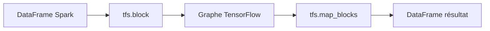

# databricks/tensorframes

> Liaison expérimentale TensorFlow pour Spark DataFrames, aujourd'hui dépréciée au profit des UDF pandas.

## Le problème
Appliquer des graphes TensorFlow aux colonnes d'un DataFrame Spark sans sortir les données de Spark.

## Ce que ça fait vraiment
- Associe des colonnes de DataFrame aux placeholders d'un graphe TensorFlow.
- Opérations par blocs : `map_blocks`, `reduce_blocks`, `analyze` pour inférer les dimensions.
- API Python et Scala (DSL limité à un sous-ensemble de TensorFlow).
- Prise en charge officielle : Spark 2.4+, Scala 2.11, Linux 64 bits.
- Le README annonce « preview technique » et des zones de faible performance.

## Comment c'est branché


## Essayer
```bash
$SPARK_HOME/bin/pyspark --packages databricks:tensorframes:0.6.0-s_2.11
build/sbt tfs_testing/assembly
build/sbt distribution/spDist
```

## Coût et pièges
Gratuit. Spark 2.4 et Scala 2.11 : piles anciennes. Dernier push en juillet 2024.

## Ce que ce n'est pas
Pas maintenu : le README dit d'utiliser `pandas UDF` à la place. Pas de support officiel hors Linux.

## Alternatives
`pandas UDF` (indiqué par le README).

## Pour toi
À ignorer : déprécié par ses propres auteurs ; utilise plutôt les UDF pandas pour de l'inférence sur Spark.

