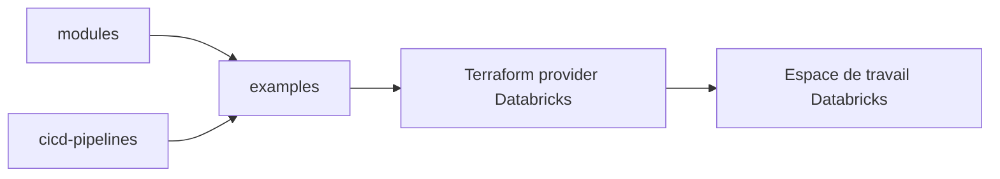

# databricks/terraform-databricks-examples

> Terraform examples and modules for deploying Databricks workspaces on Azure, AWS and GCP.

## The problem
Deploying Databricks with private networking, Unity Catalog and exfiltration protection requires complex infrastructure, hard to write without a template.

## What it actually does
The repo contains examples (examples folder), reusable modules (modules folder) and CI/CD pipelines (cicd-pipelines folder) with GitHub Actions or Azure DevOps. The examples cover an Azure lakehouse, Private Link, VNet injection, Unity Catalog, Overwatch, AWS E2 with firewall and GCP with a managed or customer-managed VPC.

## How it is wired
Simplified diagram based on the fiche, no diagram provided.


## Trying it
```bash
# Aucune commande dans le README.
# Chaque dossier d'exemple a son propre README ;
# l'exemple adb-external-hive-metastore a été retiré en février 2026.
```

## Cost and gotchas
You need a cloud account (Azure, AWS or GCP) and a Databricks account, with paid billing for the resources created. A license is present but not identified by GitHub: to be verified.

## What it is not
Not a tool to install: these are examples to adapt. Not a guarantee of a production-ready configuration. Some examples are marked as coming soon.

## Alternatives
No alternative named in the README.

## For you
Worth watching if you deploy Databricks: the Unity Catalog and private networking modules are good starting points, otherwise of no interest.
