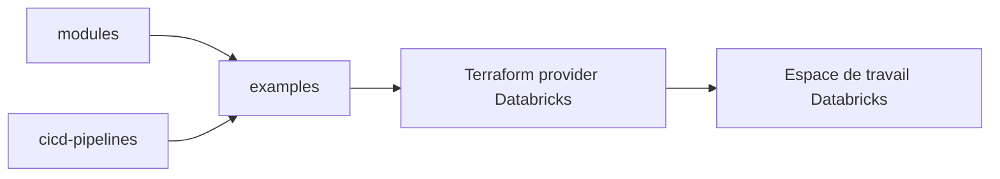

# databricks/terraform-databricks-examples

> Exemples et modules Terraform pour déployer des espaces de travail Databricks sur Azure, AWS et GCP.

## Le problème
Déployer Databricks avec réseau privé, Unity Catalog et protection contre l'exfiltration demande une infrastructure complexe, difficile à écrire sans modèle.

## Ce que ça fait vraiment
Le dépôt contient des exemples (dossier examples), des modules réutilisables (dossier modules) et des pipelines CI/CD (dossier cicd-pipelines) avec GitHub Actions ou Azure DevOps. Les exemples couvrent un lakehouse Azure, Private Link, l'injection de VNet, Unity Catalog, Overwatch, AWS E2 avec pare-feu et GCP avec VPC managé ou géré par le client.

## Comment c'est branché
Schéma simplifié d'après la fiche, sans diagramme fourni.


## Essayer
```bash
# Aucune commande dans le README.
# Chaque dossier d'exemple a son propre README ;
# l'exemple adb-external-hive-metastore a été retiré en février 2026.
```

## Coût et pièges
Il faut un compte cloud (Azure, AWS ou GCP) et un compte Databricks, avec une facturation payante des ressources créées. La licence est présente mais non identifiée par GitHub : à vérifier.

## Ce que ce n'est pas
Pas un outil à installer : ce sont des exemples à adapter. Pas une garantie de configuration prête pour la production. Certains exemples sont marqués comme à venir.

## Alternatives
Aucune alternative nommée dans le README.

## Pour toi
À surveiller si tu déploies Databricks : les modules Unity Catalog et réseau privé sont de bons points de départ, sinon sans intérêt.

