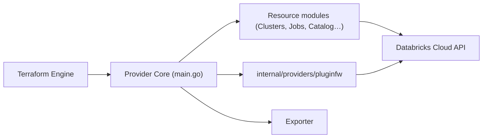

# databricks/terraform-provider-databricks

> Official Terraform provider to create and manage Databricks resources as infrastructure as code.

## The problem
Configuring Databricks clusters, jobs, notebooks and catalogs by hand in the interface cannot be versioned or reproduced.

## What it actually does
A Go plugin translates HCL into calls to the Databricks API. Modules by domain: catalog, clusters, access, dashboards, jobs, mlflow, mws, pipelines, apps. A "plugin framework" layer converts schemas and API models, with code generation. An experimental exporter produces Terraform from an existing workspace.

## How it is wired


## Trying it
```bash
terraform init
terraform apply
```
With a `main.tf` declaring `source = "databricks/databricks"`, the workspace host and a PAT token.

## Cost and gotchas
Terraform 1.1.5+; a paid Databricks workspace and a token. Migration from `databrickslabs/databricks` has to be done in the `.tf` files. 683 open issues. License not recognized by GitHub: to be checked.

## What it is not
Not a Python client nor a data management tool: it only declares the infrastructure. The exporter is experimental.

## Alternatives
No alternative cited in the README.

## For you
Adopt it if you operate Databricks: it is the official way to version MLOps infrastructure, provided you check the license.
