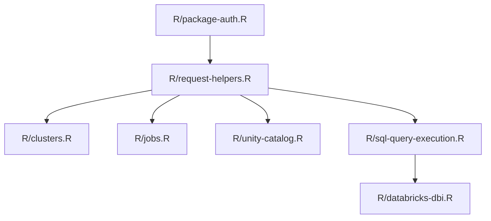

# databrickslabs/brickster

> R toolkit for Databricks: API, DBI/dbplyr backend and interactive REPL.

## The problem
R users on Databricks have to configure ODBC and write REST calls by hand.

## What it actually does
Wraps the Databricks APIs (clusters, jobs, Unity Catalog, volumes, DBFS, secrets, SQL) in R files. A DBI and dbplyr backend replaces ODBC. open_workspace() shows resources in RStudio; db_repl() runs commands on a cluster.

## How it is wired


## Trying it
```r
install.packages("brickster")
library(brickster)
Sys.setenv(DATABRICKS_HOST = "https://<workspace-prefix>.cloud.databricks.com")
open_workspace()
warehouses <- db_sql_warehouse_list()
```

## Cost and gotchas
A Databricks workspace is required, with its costs. Authentication goes through the browser or a databricks auth profile.

## What it is not
Not a replacement for Terraform, nor an account or workspace administration tool. API coverage is deliberately partial.

## Alternatives
- Terraform: infrastructure tool cited by the README for administration.

## For you
Watch: of interest if you use R on Databricks, useless otherwise.
