# databrickslabs/brickster

> Boîte à outils R pour Databricks : API, backend DBI/dbplyr et REPL interactif.

## Le problème
Les utilisateurs de R sur Databricks doivent configurer ODBC et écrire des appels REST à la main.

## Ce que ça fait vraiment
Enveloppe les API Databricks (clusters, jobs, Unity Catalog, volumes, DBFS, secrets, SQL) par fichiers R. Un backend DBI et dbplyr remplace ODBC. open_workspace() affiche les ressources dans RStudio ; db_repl() exécute des commandes sur un cluster.

## Comment c'est branché

```mermaid
flowchart TD
  A["R/package-auth.R"] --> B["R/request-helpers.R"]
  B --> C["R/clusters.R"]
  B --> D["R/jobs.R"]
  B --> E["R/unity-catalog.R"]
  B --> F["R/sql-query-execution.R"]
  F --> G["R/databricks-dbi.R"]
```


## Essayer
```r
install.packages("brickster")
library(brickster)
Sys.setenv(DATABRICKS_HOST = "https://<workspace-prefix>.cloud.databricks.com")
open_workspace()
warehouses <- db_sql_warehouse_list()
```

## Coût et pièges
Un espace de travail Databricks est requis, avec ses coûts. L'authentification passe par le navigateur ou un profil databricks auth.

## Ce que ce n'est pas
Pas un remplaçant de Terraform ni un outil d'administration de compte ou d'espace de travail. Couverture des API volontairement partielle.

## Alternatives
- Terraform : outil d'infrastructure cité par le README pour l'administration.

## Pour toi
Surveiller : intéressant si tu utilises R sur Databricks, inutile sinon.

