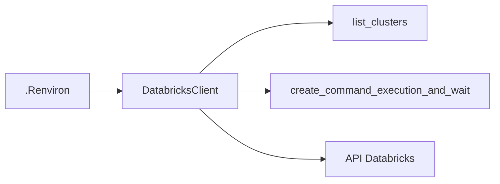

# databrickslabs/databricks-sdk-r

> Experimental R SDK to drive Databricks workspace-level APIs.

## The problem
Automating a Databricks workspace from R without writing REST calls by hand.

## What it actually does
R client covering all public workspace-level APIs, consistent with the Python, Go and Java SDKs. `list` methods return a complete `data.frame`, and long-running operations (`create_cluster_and_wait`) poll until the desired state. Account-level APIs are not exposed.

## How it is wired
Simplified diagram based on the sheet, no diagram provided.


## Trying it
```r
library(dplyr)
library(databricks)
client <- DatabricksClient()
running <- list_clusters(client) %>% filter(state == 'RUNNING')
```

## Cost and gotchas
Only personal token authentication (`DATABRICKS_HOST`, `DATABRICKS_TOKEN`) works. A paid Databricks workspace is required. Last push in April 2024. The README does not give the install command.

## What it is not
Not an account-level or production SDK: labeled experimental, with possible breaking changes.

## Alternatives
- Databricks SDK for Python, Go or Java: the only ones recommended for account-level automation.

## For you
Watch: only useful if your team works in R on Databricks, but inactive since 2024.
