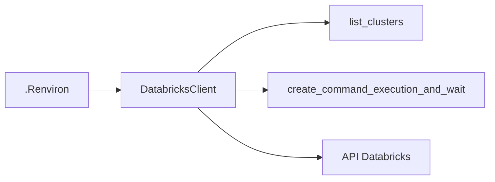

# databrickslabs/databricks-sdk-r

> SDK expérimental en R pour piloter les API de niveau espace de travail de Databricks.

## Le problème
Automatiser un espace de travail Databricks depuis R sans écrire les appels REST à la main.

## Ce que ça fait vraiment
Client R couvrant toutes les API publiques de niveau espace de travail, cohérent avec les SDK Python, Go et Java. Les méthodes `list` renvoient un `data.frame` complet, et les opérations longues (`create_cluster_and_wait`) sondent jusqu'à l'état voulu. Les API de niveau compte ne sont pas exposées.

## Comment c'est branché
Schéma simplifié d'après la fiche, sans diagramme fourni.


## Essayer
```r
library(dplyr)
library(databricks)
client <- DatabricksClient()
running <- list_clusters(client) %>% filter(state == 'RUNNING')
```

## Coût et pièges
Seule l'authentification par jeton personnel (`DATABRICKS_HOST`, `DATABRICKS_TOKEN`) fonctionne. Un espace Databricks payant est nécessaire. Dernier push en avril 2024. Le README ne donne pas la commande d'installation.

## Ce que ce n'est pas
Pas un SDK de comptes ni de production : étiqueté expérimental, avec de possibles changements incompatibles.

## Alternatives
- Databricks SDK pour Python, Go ou Java : seuls recommandés pour l'automatisation au niveau compte.

## Pour toi
À surveiller : utile seulement si ton équipe travaille en R sur Databricks, mais inactif depuis 2024.

