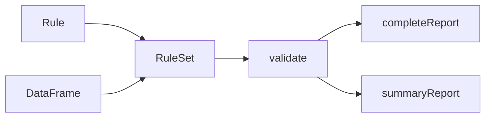

# databrickslabs/dataframe-rules-engine

> Scala library that validates business rules on Spark DataFrames, in batch or streaming.

## The problem
Checking data quality between the bronze, silver and gold layers requires hand-writing scattered checks.

## What it actually does
You define rules (simple, implicit boolean, bounds, categorical), build a `RuleSet` on a DataFrame, optionally grouped, then `validate()` returns a complete report and a summary report of the failures. Streaming DataFrames are supported since version 0.2.

## How it is wired


## Trying it
```bash
sbt clean package
sbt test
sbt jacoco
```
Dependency: `libraryDependencies += "com.databricks.labs" %% "dataframe-rules-engine" % "0.2.0"`.

## Cost and gotchas
You need Scala, Spark and JDK 8 for the tests. The project is not officially supported by Databricks. Last push in May 2024.

## What it is not
Not a supported product: the README states that its future depends on Delta Pipelines and Expectations. No Python wrapper (idea only listed).

## Alternatives
No alternative named in the README, apart from Delta Pipelines Expectations cited as the likely successor.

## For you
Ignore: old, unsupported and replaceable by Databricks Expectations, unless you already maintain Spark Scala.
