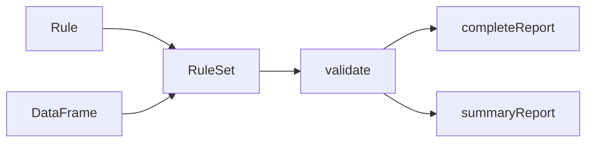

# databrickslabs/dataframe-rules-engine

> Bibliothèque Scala qui valide des règles métier sur des DataFrames Spark, en lot ou en streaming.

## Le problème
Contrôler la qualité des données entre les couches bronze, silver et gold impose d'écrire à la main des vérifications dispersées.

## Ce que ça fait vraiment
On définit des règles (simples, booléennes implicites, bornes, catégorielles), on construit un `RuleSet` sur un DataFrame, éventuellement groupé, puis `validate()` renvoie un rapport complet et un rapport de synthèse des échecs. Les DataFrames en streaming sont gérés depuis la version 0.2.

## Comment c'est branché


## Essayer
```bash
sbt clean package
sbt test
sbt jacoco
```
Dépendance : `libraryDependencies += "com.databricks.labs" %% "dataframe-rules-engine" % "0.2.0"`.

## Coût et pièges
Il faut Scala, Spark et JDK 8 pour les tests. Le projet n'est pas supporté officiellement par Databricks. Dernier push en mai 2024.

## Ce que ce n'est pas
Pas un produit supporté : le README annonce que son avenir dépend de Delta Pipelines et des Expectations. Pas de wrapper Python (idée listée seulement).

## Alternatives
Aucune alternative nommée dans le README, hormis les Expectations de Delta Pipelines citées comme successeur probable.

## Pour toi
À ignorer : ancien, non supporté et remplaçable par les Expectations de Databricks, sauf si tu maintiens déjà du Spark Scala.

