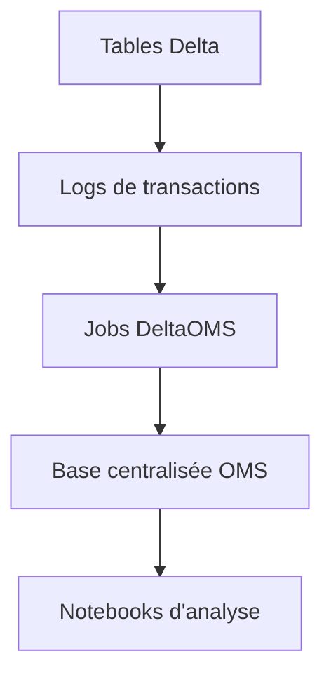

# databrickslabs/delta-oms

> Centralized repository of Delta transaction logs and their metrics, for those running a Databricks lakehouse.

## The problem
Operation metrics of Delta tables are scattered; you cannot see who writes what, nor at what pace.

## What it actually does
Subscribes to the Delta logs of the configured databases and tables, enriches the metrics (path, file, timestamp), builds snapshots and stores them in action and commit tables. Used for write tracking, auditing, alerting and proof of GDPR deletions. Delivered as a jar and notebooks.

## How it is wired
Simplified diagram based on the sheet, no diagram provided.


## Trying it
```bash
sbt clean compile test
sbt clean compile assembly
```

## Cost and gotchas
No direct cost, but the jobs run on your Databricks environment, so they are at your expense. Scala and sbt required to build. Last push in November 2023.

## What it is not
Not a data quality tool nor a catalog: it collects write metrics. A lab project, with no promise of support.

## Alternatives
No alternative named in the README.

## For you
Worth watching if your lakehouse is on Databricks and you want to audit writes; the age of the last push means you must check compatibility.
