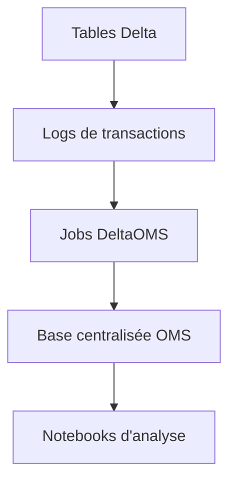

# databrickslabs/delta-oms

> Dépôt centralisé des journaux de transactions Delta et de leurs métriques, pour qui exploite un lakehouse Databricks.

## Le problème
Les métriques d'opérations des tables Delta sont dispersées ; on ne voit pas qui écrit quoi ni à quel rythme.

## Ce que ça fait vraiment
S'abonne aux logs Delta des bases et tables configurées, enrichit les métriques (chemin, fichier, horodatage), construit des instantanés et les stocke en tables d'actions et de commits. Sert au suivi d'écritures, à l'audit, à l'alerte et à la preuve de suppressions RGPD. Livré en jar et notebooks.

## Comment c'est branché
Schéma simplifié d'après la fiche, sans diagramme fourni.


## Essayer
```bash
sbt clean compile test
sbt clean compile assembly
```

## Coût et pièges
Pas de coût direct, mais les jobs tournent sur ton environnement Databricks, donc à ta charge. Scala et sbt requis pour compiler. Dernier push en novembre 2023.

## Ce que ce n'est pas
Pas un outil de qualité de données ni un catalogue : il collecte des métriques d'écriture. Projet de laboratoire, sans promesse de support.

## Alternatives
Aucune alternative nommée dans le README.

## Pour toi
À surveiller si ton lakehouse est sur Databricks et que tu veux auditer les écritures ; l'ancienneté du dernier push impose de vérifier la compatibilité.

