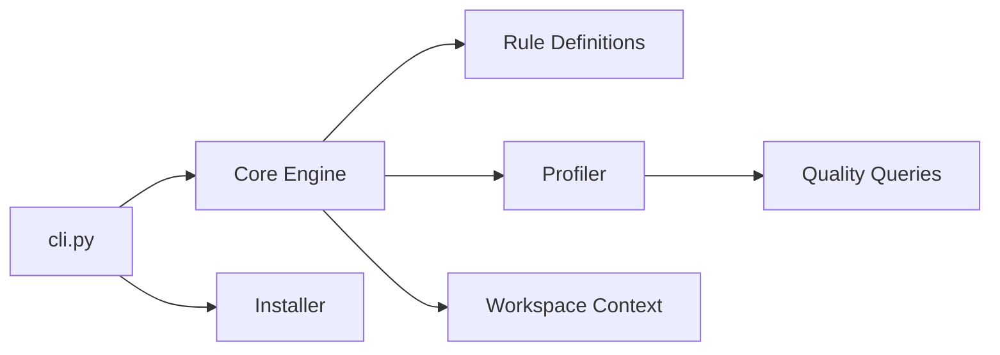

# databrickslabs/dqx

> Data quality checking library for PySpark DataFrames, batch and streaming, on Databricks.

## The problem
Invalid data flows through Spark pipelines with no explicit rules and no traceability of failures.

## What it actually does
More than 80 built-in checks (nulls, ranges, regex, references, aggregates, geo, PII), defined in code or in YAML/JSON, with a warning or error level, and a reaction (reject, flag, quarantine). It adds profiling with rule generation, LLM-assisted rules (DSPy), anomaly detection with Isolation Forest, ODCS data contracts, metrics in Delta with a Lakeview dashboard, Slack/Teams alerts, DQX Studio and an MCP server.

## How it is wired


## Trying it
```bash
# Aucune commande d'installation dans le README : voir https://databrickslabs.github.io/dqx/
```

## Cost and gotchas
The library is free, but Databricks (or Spark) is required; Model Serving for the LLM functions, and billed Databricks resources for the dashboard and Studio. The licence is not recognised by GitHub. Labs project: community support.

## What it is not
Not a tool for use outside Spark: it is designed for PySpark. The README gives no installation command and no code example.

## Alternatives
No alternative named in the README.

## For you
Adopt it if you do data work on Spark/Databricks: declarative and streaming quality control, but check the licence before any sensitive use.
