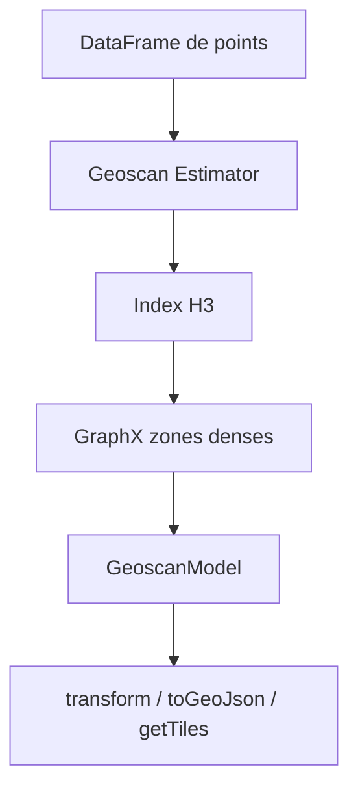

# databrickslabs/geoscan

> Distributed geospatial DBSCAN on Spark with H3 and GraphX, for detecting behaviors in transactions.

## The problem
DBSCAN compares every point to all the others, which does not scale to millions of geolocated transactions.

## What it actually does
A Spark estimator that groups points by H3 cells, then detects dense areas with GraphX (distributed mode) or in memory with scalax (pseudo-distributed mode, one model per user). The model can be serialized, rendered as GeoJSON and as H3 tiles via `getTiles`. Parameters: `epsilon` (meters, 50 by default) and `minPts` (3).

## How it is wired
Simplified diagram based on the sheet, no diagram provided.



## Trying it
```bash
pip install geoscan==0.1
mvn clean package -Pshaded
```

## Cost and gotchas
Needs a Spark cluster (Databricks DBR above 9.1), and the Scala library in addition to the PyPI package. A license is present but not identified: check it before use.

## What it is not
Not a standalone Python library: the core is in Scala and requires Spark. Archived, last push 2026-03.

## Alternatives
None cited in the README.

## For you
Watch: a useful idea (DBSCAN via H3) for large-scale fraud detection, but archived, at version 0.1 and with a license to clarify.
