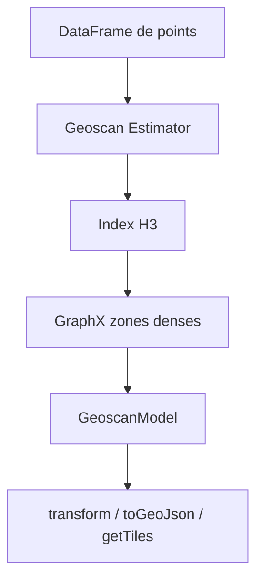

# databrickslabs/geoscan

> DBSCAN géospatial distribué sur Spark avec H3 et GraphX, pour détecter des comportements dans des transactions.

## Le problème
DBSCAN compare chaque point à tous les autres, ce qui ne passe pas à l'échelle sur des millions de transactions géolocalisées.

## Ce que ça fait vraiment
Un estimateur Spark qui regroupe les points par cellules H3, puis détecte les zones denses avec GraphX (mode distribué) ou en mémoire avec scalax (mode pseudo-distribué, un modèle par utilisateur). Le modèle se sérialise, se rend en GeoJSON et en tuiles H3 via `getTiles`. Paramètres : `epsilon` (mètres, 50 par défaut) et `minPts` (3).

## Comment c'est branché
Schéma simplifié d'après la fiche, sans diagramme fourni.



## Essayer
```bash
pip install geoscan==0.1
mvn clean package -Pshaded
```

## Coût et pièges
Besoin d'un cluster Spark (Databricks DBR au-dessus de 9.1), de la bibliothèque Scala en plus du paquet PyPI. Licence présente mais non identifiée : à vérifier avant usage.

## Ce que ce n'est pas
Pas une bibliothèque Python autonome : le coeur est en Scala et exige Spark. Archivé, dernier push 2026-03.

## Alternatives
Aucune citée dans le README.

## Pour toi
À surveiller : idée utile (DBSCAN par H3) pour de la détection de fraude à grande échelle, mais archivé, en version 0.1 et licence à clarifier.

