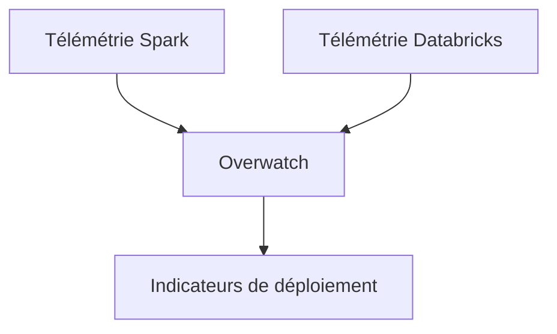

# databrickslabs/overwatch

> Databricks Labs tool unifying Spark and Databricks telemetry to understand a deployment; deprecated.

## The problem
Getting an overview of the activity and cost of a Databricks deployment requires gathering several telemetry sources.

## What it actually does
The README is very short (insufficient material): it talks about unifying Spark and Databricks platform telemetry to give insights into deployments. The details of how it works, the tables produced and the installation are not documented here; it points to GitHub Pages pages.

## How it is wired
Simplified diagram based on the sheet, no diagram provided.

## Trying it
No documented command in the README: it points to the documentation published on GitHub Pages.

## Cost and gotchas
Assumes a Databricks workspace (third-party service, pricing not specified here). Deprecated, archived repository with no maintenance; 142 open issues remain unanswered.

## What it is not
Not a living project: the code remains available for forking only. It is not a monitoring tool independent of Databricks.

## Alternatives
No alternative named in the README.

## For you
Ignore: deprecated and archived, and the license is not identified; for Databricks monitoring, look at the platform's native features.
