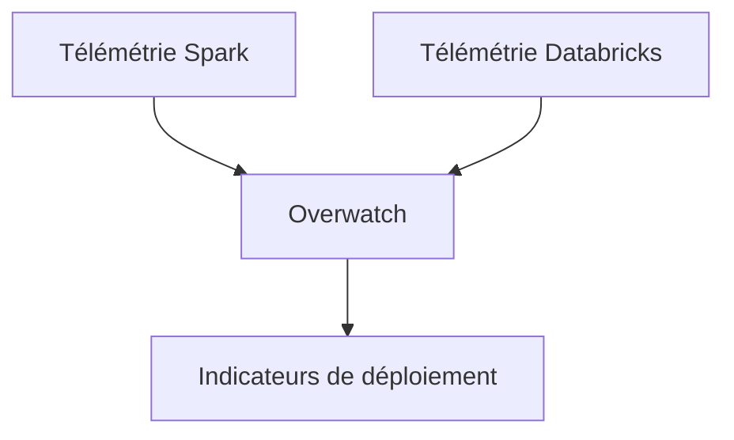

# databrickslabs/overwatch

> Outil Databricks Labs unifiant la télémétrie Spark et Databricks pour comprendre un déploiement ; déprécié.

## Le problème
Obtenir une vue d'ensemble de l'activité et du coût d'un déploiement Databricks demande de rassembler plusieurs sources de télémétrie.

## Ce que ça fait vraiment
Le README est très court (matière insuffisante) : il parle d'unifier la télémétrie Spark et de la plateforme Databricks pour donner des indications sur les déploiements. Le détail du fonctionnement, des tables produites et de l'installation n'est pas documenté ici, il renvoie à des pages GitHub Pages.

## Comment c'est branché
Schéma simplifié d'après la fiche, sans diagramme fourni.

## Essayer
Aucune commande documentée dans le README : renvoi vers la documentation publiée sur GitHub Pages.

## Coût et pièges
Suppose un espace de travail Databricks (service tiers, tarif non précisé ici). Dépôt déprécié, archivé et sans maintenance ; 142 issues ouvertes restent sans suite.

## Ce que ce n'est pas
Pas un projet vivant : le code reste disponible pour fork seulement. Ce n'est pas un outil de supervision indépendant de Databricks.

## Alternatives
Aucune alternative nommée dans le README.

## Pour toi
À ignorer : déprécié et archivé, et la licence n'est pas identifiée ; pour du suivi Databricks, regarde les fonctions natives de la plateforme.

