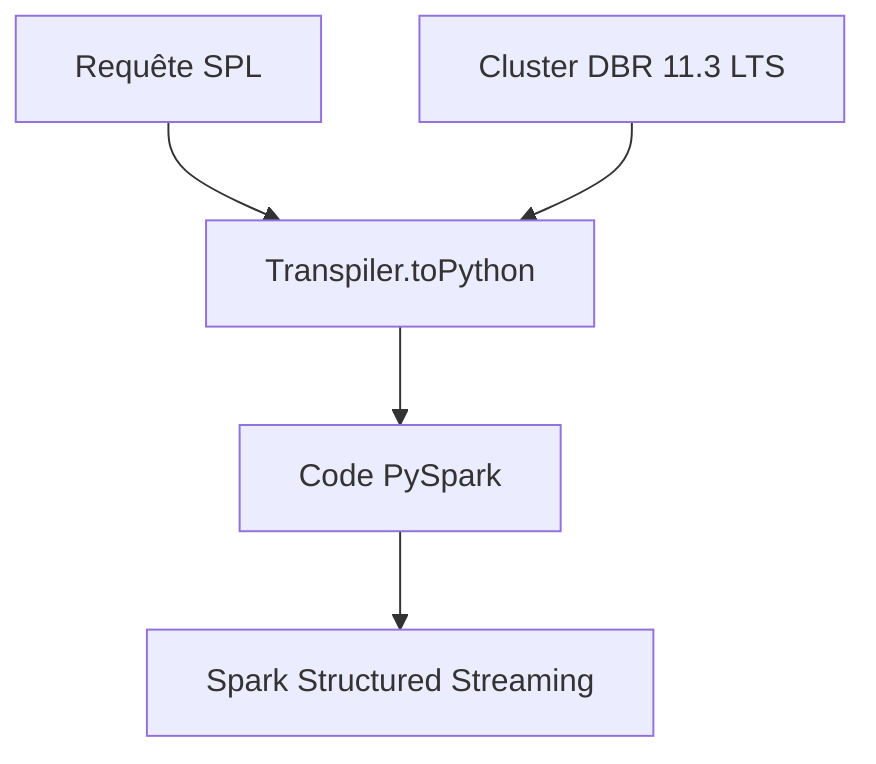

# databrickslabs/transpiler

> Translator from Splunk SPL queries to PySpark code, for migrating SIEM rules to Databricks.

## The problem
Translating hundreds of SPL queries to PySpark by hand takes months and requires dual expertise.

## What it actually does
A Scala library installed on a Databricks cluster (DBR 11.3 LTS), called through `Transpiler.toPython` from Scala or Python. It converts common SPL commands (stats, eval, join, rex, fillnull, streamstats, mvexpand, convert, etc.) into PySpark DataFrame code. The README shows about fifty translated cases. The end of the README is truncated in the material provided.

## How it is wired
Simplified diagram based on the sheet, no diagram provided.



## Trying it
```python
def transpile(query: str):
    from pyspark.sql import SparkSession
    spark = SparkSession.getActiveSession()
    spl = spark._jvm.com.databricks.labs.transpiler.spl
    code = spl.Transpiler.toPython(query)
    print(code)

transpile('index=security_log | bin span=5m timestamp | stats count by timestamp | sort timestamp')
```
Cluster-side installation: Maven library `com.databricks.labs:transpiler:0.4.0`.

## Cost and gotchas
Databricks cluster on DBR 11.3 LTS only, otherwise it does not work. Only common commands are covered. License not identified.

## What it is not
Not a complete SPL converter: the README talks about the most used commands. Archived.

## Alternatives
Uncoder.io and SigmaHQ/sigma, cited in the README, translate other SIEM formats but not to PySpark.

## For you
Worth watching: only if you are migrating a Splunk SIEM to Databricks; otherwise the idea is instructive but the repo is archived and locked to DBR 11.3.
