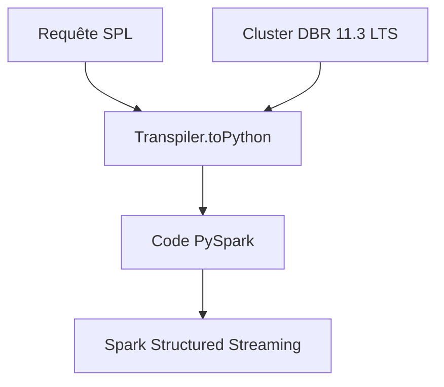

# databrickslabs/transpiler

> Traducteur de requêtes Splunk SPL vers du code PySpark, pour migrer des règles SIEM vers Databricks.

## Le problème
Traduire à la main des centaines de requêtes SPL vers PySpark prend des mois et exige une double expertise.

## Ce que ça fait vraiment
Une bibliothèque Scala installée sur un cluster Databricks (DBR 11.3 LTS), appelée par `Transpiler.toPython` depuis Scala ou Python. Elle convertit des commandes SPL courantes (stats, eval, join, rex, fillnull, streamstats, mvexpand, convert, etc.) en code PySpark DataFrame. Le README montre une cinquantaine de cas traduits. La fin du README est tronquée dans la matière fournie.

## Comment c'est branché
Schéma simplifié d'après la fiche, sans diagramme fourni.



## Essayer
```python
def transpile(query: str):
    from pyspark.sql import SparkSession
    spark = SparkSession.getActiveSession()
    spl = spark._jvm.com.databricks.labs.transpiler.spl
    code = spl.Transpiler.toPython(query)
    print(code)

transpile('index=security_log | bin span=5m timestamp | stats count by timestamp | sort timestamp')
```
Installation côté cluster : bibliothèque Maven `com.databricks.labs:transpiler:0.4.0`.

## Coût et pièges
Cluster Databricks en DBR 11.3 LTS uniquement, sinon cela ne marche pas. Seules les commandes courantes sont couvertes. Licence non identifiée.

## Ce que ce n'est pas
Pas un convertisseur complet de SPL : le README parle des commandes les plus utilisées. Archivé.

## Alternatives
Uncoder.io et SigmaHQ/sigma, cités dans le README, traduisent d'autres formats de SIEM mais pas vers PySpark.

## Pour toi
À surveiller : seulement si tu migres un SIEM Splunk vers Databricks ; sinon l'idée est instructive mais le dépôt est archivé et verrouillé sur DBR 11.3.

