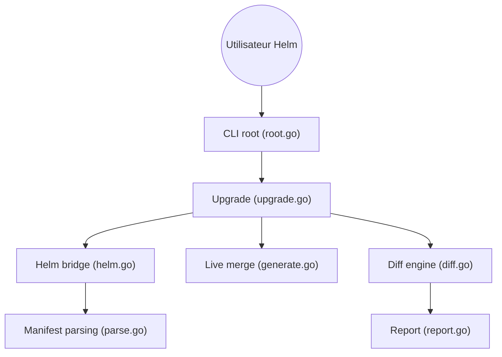

# databus23/helm-diff

> Helm plugin that shows what a `helm upgrade` would change before applying it.

## The problem
A Helm upgrade changes the cluster blindly: you discover the change after the fact.

## What it actually does
The plugin compares the deployed version of a release with a rendered chart (or with `helm upgrade --dry-run`). It can also compare two revisions, preview a rollback, or compare two local charts. Outputs: diff, structured JSON, template or dyff; an external tool is possible. The `--three-way-merge` mode takes the real state of the cluster into account, server side (dry-run) or client side.

## How it is wired


## Trying it
```bash
helm plugin install https://github.com/databus23/helm-diff
helm diff upgrade prod api ./charts/api --output structured
helm diff upgrade api ./charts/api --diff-tool "diff -u -N"
```

## Cost and gotchas
Free, requires Helm 3.18 or later and access to the cluster. Under Helm 4, provenance verification requires installing from the signed archive. The client mode of the three-way merge can hide a manual drift: server mode is more faithful but requires the `patch` permission.

## What it is not
Not a deployment tool: it modifies nothing. It does not replace reviewing your chart.

## Alternatives
No alternative cited in the README.

## For you
Adopt if you deploy Helm charts (model serving, MLOps tools): the preview before upgrade costs almost nothing, but the project relies on a single maintainer.
