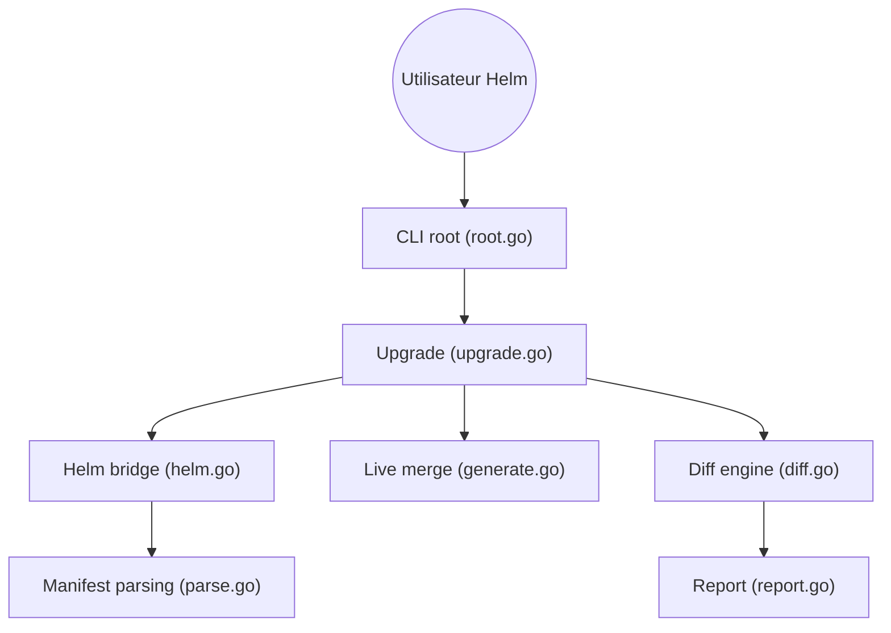

# databus23/helm-diff

> Plugin Helm qui montre ce qu'un `helm upgrade` changerait avant de l'appliquer.

## Le problème
Un upgrade Helm modifie le cluster à l'aveugle : on découvre le changement après coup.

## Ce que ça fait vraiment
Le plugin compare la version déployée d'une release à un chart rendu (ou à `helm upgrade --dry-run`). Il sait aussi comparer deux révisions, prévisualiser un rollback, ou comparer deux charts locaux. Sorties : diff, JSON structuré, template ou dyff ; outil externe possible. Le mode `--three-way-merge` tient compte de l'état réel du cluster, côté serveur (dry-run) ou client.

## Comment c'est branché


## Essayer
```bash
helm plugin install https://github.com/databus23/helm-diff
helm diff upgrade prod api ./charts/api --output structured
helm diff upgrade api ./charts/api --diff-tool "diff -u -N"
```

## Coût et pièges
Gratuit, nécessite Helm 3.18 ou plus et l'accès au cluster. Sous Helm 4, la vérification de provenance impose d'installer depuis l'archive signée. Le mode client du merge à trois voies peut taire une dérive manuelle : le mode serveur est plus fidèle mais demande la permission `patch`.

## Ce que ce n'est pas
Pas un outil de déploiement : il ne modifie rien. Il ne remplace pas la revue de ton chart.

## Alternatives
Aucune alternative citée dans le README.

## Pour toi
À adopter si tu déploies des charts Helm (serving de modèles, outils MLOps) : l'aperçu avant upgrade coûte presque rien, mais le projet repose sur un mainteneur.

