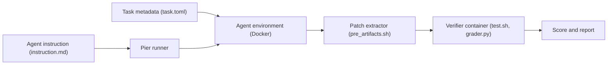

# datacurve-ai/deep-swe

> A benchmark of 113 long software-engineering tasks, for evaluating coding agents.

## The problem
Short coding benchmarks are saturated; long tasks on real, active repositories are needed.

## What it actually does
A collection of tasks in Harbor format (TypeScript, Go, Python, JavaScript, Rust): `task.toml`, `instruction.md`, environment Dockerfile, held-out tests and a reference solution. The agent works in an isolated container and commits; `pre_artifacts.sh` extracts a patch from it, applied in a fresh verifier container, with structured scores. Run by the external Pier runner.

## How it is wired


## Trying it
```bash
git clone https://github.com/datacurve-ai/deep-swe
uv tool install datacurve-pier
export ANTHROPIC_API_KEY=...
pier run -p deep-swe/tasks --agent mini-swe-agent --model anthropic/claude-opus-4-8
pier run -p deep-swe/tasks --agent mini-swe-agent --n-tasks 10 --sample-seed 0
```

## Cost and gotchas
LLM keys at your expense; Docker and Pier; Modal optional for parallelism. The cost of a full run is not stated.

## What it is not
Not an application: no service, only a corpus. The leaderboard scores come from the publisher (Pier and mini-swe-agent on Modal).

## Alternatives
No alternative named in the README.

## For you
Worth watching: useful for comparing coding agents, but running all 113 tasks is expensive, so measure on a subset first.
