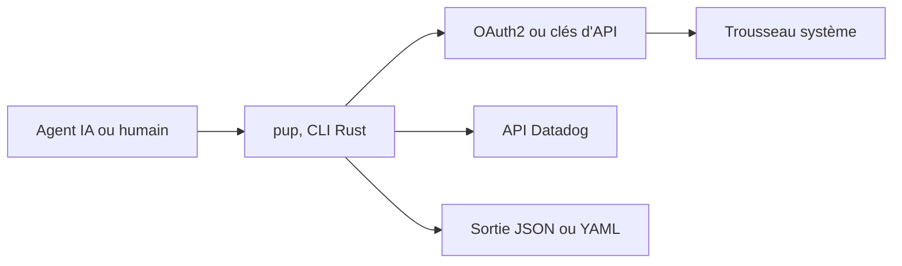

# datadog-labs/pup

> Datadog command line designed for AI agents: metrics, logs, monitors, incidents and security.

## The problem
An agent that needs to read Datadog runs into a vast API, long-lived keys and outputs that are hard to parse.

## What it actually does
A Rust binary that covers many areas of the Datadog API: metrics, logs, traces, RUM, monitors, SLOs, incidents, security, costs and LLM Observability. JSON or YAML output, discoverable commands, OAuth2 login with PKCE, fallback to API keys. `pup setup` helps instrument a project.

## How it is wired
Simplified diagram based on the sheet, no diagram provided.



## Trying it
```bash
curl -fsSL https://raw.githubusercontent.com/DataDog/pup/main/install.sh | sh
pup auth login
pup monitors list --tags="team:api-platform"
pup logs search --query="status:error" --from="1h"
npx @datadog/pup auth login
```

## Cost and gotchas
You need a Datadog account, a paid service, and OAuth2 authentication requires dynamic client registration on your site. `pup setup` requires Node.js 22 or later. Several areas remain unsupported (Powerpacks, IP Allowlist).

## What it is not
Not a free alternative to Datadog: it is only a client. Profiling is not supported, and the README points to Datadog's MCP server.

## Alternatives
The Datadog MCP server, mentioned for profiling.

## For you
Worth watching if you already use Datadog: giving an agent scoped read access to logs and metrics is useful for MLOps.
