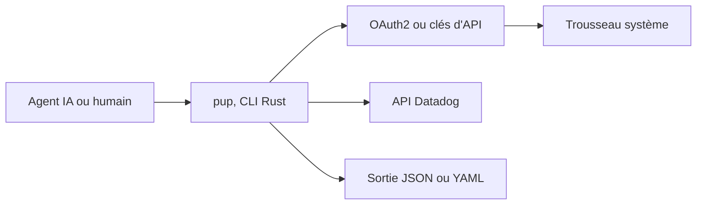

# datadog-labs/pup

> Ligne de commande Datadog conçue pour les agents IA : métriques, logs, monitors, incidents et sécurité.

## Le problème
Un agent qui doit lire Datadog se heurte à une API vaste, à des clés longue durée et à des sorties difficiles à parser.

## Ce que ça fait vraiment
Un binaire Rust qui couvre de nombreux domaines de l'API Datadog : métriques, logs, traces, RUM, monitors, SLO, incidents, sécurité, coûts et LLM Observability. Sortie JSON ou YAML, commandes découvrables, connexion OAuth2 avec PKCE, repli sur clés d'API. `pup setup` aide à instrumenter un projet.

## Comment c'est branché
Schéma simplifié d'après la fiche, sans diagramme fourni.



## Essayer
```bash
curl -fsSL https://raw.githubusercontent.com/DataDog/pup/main/install.sh | sh
pup auth login
pup monitors list --tags="team:api-platform"
pup logs search --query="status:error" --from="1h"
npx @datadog/pup auth login
```

## Coût et pièges
Il faut un compte Datadog, service payant, et l'authentification OAuth2 exige l'enregistrement dynamique de client sur ton site. `pup setup` demande Node.js 22 ou plus. Plusieurs domaines restent non pris en charge (Powerpacks, IP Allowlist).

## Ce que ce n'est pas
Pas une alternative libre à Datadog : c'est seulement un client. Profiling n'est pas pris en charge, et le README renvoie au serveur MCP de Datadog.

## Alternatives
Le serveur MCP de Datadog, cité pour le profiling.

## Pour toi
À surveiller si tu utilises déjà Datadog : donner à un agent un accès scopé en lecture à logs et métriques est utile pour du MLOps.

