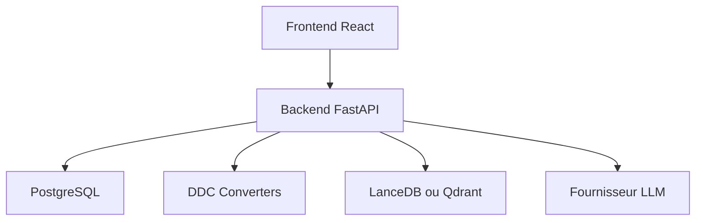

# datadrivenconstruction/OpenConstructionERP

> Self-hosted construction site management platform: takeoffs, costs, scheduling, tenders, with AI estimation.

## The problem
Construction estimating software is expensive, closed and tied to a region. Here, an open cost database and takeoff editor.

## What it actually does
A bill-of-quantities editor with validation rules (DIN 276, NRM, MasterFormat), 120,000 cost items, quantity takeoff from RVT, IFC, DWG and PDF, and export to GAEB, Excel or PDF. AI estimation goes through the LLM provider of your choice. FastAPI backend, React frontend, PostgreSQL embedded locally.

## How it is wired
Simplified diagram based on the fiche, no diagram provided.



## Trying it
```bash
pip install --upgrade openconstructionerp
openconstructionerp
```
Then open `http://localhost:8080`.

## Cost and gotchas
Free; AI estimation requires an API key from your provider. Python 3.12 minimum. Desktop installers are not signed. Demo accounts with a public password: change the passwords before any exposure.

## What it is not
Not a full financial ERP despite its name: the tool targets construction. The project dates from April 2026, and its comparison figures are the author's own.

## Alternatives
No alternative named in the README, apart from unnamed categories of proprietary software.

## For you
Worth watching: interesting as an example of a CAD/BIM-to-structured-data pipeline with AI, but a very specific trade and a young project.
