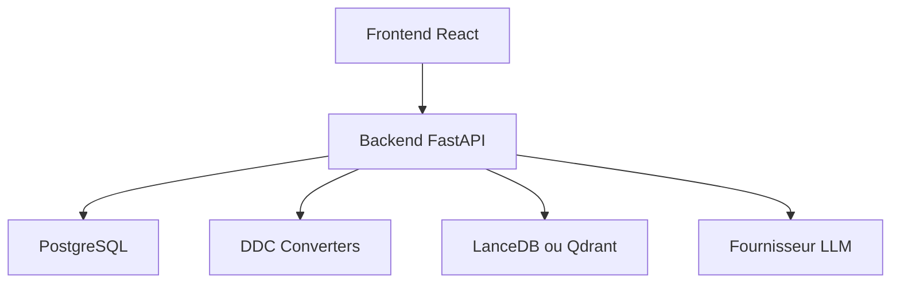

# datadrivenconstruction/OpenConstructionERP

> Plateforme auto-hébergée de gestion de chantier : métrés, coûts, planning, appels d'offres, avec estimation par IA.

## Le problème
Les logiciels d'estimation de chantier sont chers, fermés et liés à une région. Ici, une base de coûts et un éditeur de métrés libres.

## Ce que ça fait vraiment
Un éditeur de bordereaux de quantités avec règles de validation (DIN 276, NRM, MasterFormat), 120 000 postes de coûts, relevé de quantités depuis RVT, IFC, DWG et PDF, et export GAEB, Excel ou PDF. L'estimation par IA passe par le fournisseur de LLM de ton choix. Backend FastAPI, frontend React, PostgreSQL embarqué en local.

## Comment c'est branché
Schéma simplifié d'après la fiche, sans diagramme fourni.



## Essayer
```bash
pip install --upgrade openconstructionerp
openconstructionerp
```
Puis ouvrir `http://localhost:8080`.

## Coût et pièges
Gratuit ; l'estimation IA demande une clé d'API de ton fournisseur. Python 3.12 minimum. Les installeurs bureau ne sont pas signés. Comptes démo au mot de passe public : changer les mots de passe avant toute exposition.

## Ce que ce n'est pas
Pas un ERP financier complet malgré son nom : l'outil vise la construction. Le projet date d'avril 2026, et ses chiffres de comparaison sont ceux de l'auteur.

## Alternatives
Aucune alternative nommée dans le README, hors catégories de logiciels propriétaires non nommés.

## Pour toi
À surveiller : intéressant comme exemple de pipeline CAD/BIM vers données structurées avec IA, mais métier très spécifique et projet jeune.

