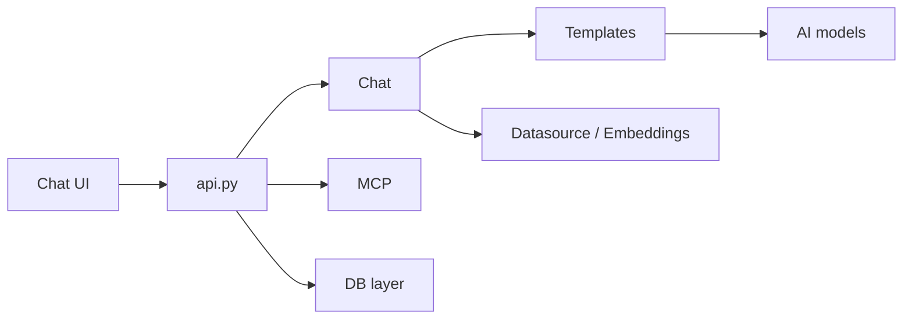

# dataease/SQLBot

> Self-hosted text-to-SQL system (ChatBI) with RAG, for querying your databases in natural language.

## The problem
Business users depend on analysts for every SQL query; an LLM alone generates wrong SQL without business context.

## What it actually does
FastAPI backend: data sources, row/column permissions per workspace, table embeddings for RAG.
SQL generation, charts and analyses via prompt templates; business glossary and SQL examples to calibrate.
Vue front end with chat, dashboards, embedded mode; MCP module so it can be called by other agents.
OpenAI-compatible LLM providers (DeepSeek, Qwen, Kimi, Gemini...).

## How it is wired


## Trying it
```bash
docker run -d --name sqlbot --restart unless-stopped -p 8000:8000 -p 8001:8001 -v ./data/sqlbot/excel:/opt/sqlbot/data/excel -v ./data/sqlbot/file:/opt/sqlbot/data/file -v ./data/sqlbot/images:/opt/sqlbot/images -v ./data/sqlbot/logs:/opt/sqlbot/app/logs -v ./data/postgresql:/var/lib/postgresql/data --privileged=true dataease/sqlbot
```

## Cost and gotchas
LLM API key at your expense; container runs with `--privileged`, default admin password to change.
License not identified by GitHub: read it before commercial use.

## What it is not
Not a text-to-SQL library that can be embedded in Python.
Not guaranteed accurate: quality depends on the glossary and examples provided.

## Alternatives
- DataEase: open-source BI from the same publisher, without conversation.
- MaxKB: agent platform from the same publisher.

## For you
Worth watching: very relevant ChatBI use case for data work, to be evaluated seriously once the license is clarified.
