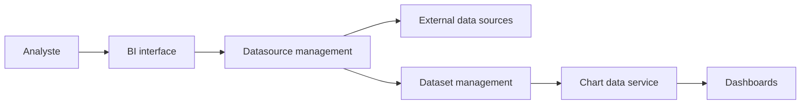

# dataease/dataease

> Open-source drag-and-drop BI tool for analyzing data and sharing dashboards.

## The problem
Business teams need charts on their data without writing code.

## What it actually does
Connects to OLTP databases (MySQL, PostgreSQL, Oracle…), OLAP (ClickHouse, Doris, StarRocks), warehouses (Redshift), Excel/CSV files and APIs; creates datasets and charts by drag and drop, dashboards, a spreadsheet (Univer), templates and exports. Stack: Vue.js/Element, AntV, Spring Boot, MySQL, Calcite, SeaTunnel. README in Chinese.

## How it is wired


## Trying it
```bash
tar zxvf dataease-offline-installer-v3.0.0.tar.gz
cd dataease-offline-installer-v3.0.0
bash install.sh
```

## Cost and gotchas
Linux server with 2 cores / 4 GB minimum. Default admin password documented (`DataEase@123456`): change it. License not identified by GitHub.

## What it is not
Not a modeling or ML tool. Documentation is in Chinese.

## Alternatives
No alternative named in the README.

## For you
Self-service BI comparable to others; worth a look if you want a self-hosted dashboard tool, after reading the license.
