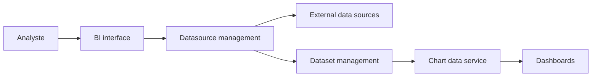

# dataease/dataease

> Outil de BI open source en glisser-déposer, pour analyser et partager des tableaux de bord.

## Le problème
Les équipes métier ont besoin de graphiques sur leurs données sans écrire de code.

## Ce que ça fait vraiment
Se connecte à des bases OLTP (MySQL, PostgreSQL, Oracle…), OLAP (ClickHouse, Doris, StarRocks), entrepôts (Redshift), fichiers Excel/CSV et API ; crée des jeux de données et des graphiques par glisser-déposer, des tableaux de bord, un tableur (Univer), des modèles et des exports. Pile : Vue.js/Element, AntV, Spring Boot, MySQL, Calcite, SeaTunnel. README en chinois.

## Comment c'est branché


## Essayer
```bash
tar zxvf dataease-offline-installer-v3.0.0.tar.gz
cd dataease-offline-installer-v3.0.0
bash install.sh
```

## Coût et pièges
Serveur Linux 2 cœurs / 4 Go minimum. Mot de passe admin par défaut documenté (`DataEase@123456`) : à changer. Licence non identifiée par GitHub.

## Ce que ce n'est pas
Pas un outil de modélisation ni de ML. La documentation est en chinois.

## Alternatives
Aucune alternative nommée dans le README.

## Pour toi
BI libre-service comparable à d'autres ; à regarder si tu cherches un outil auto-hébergé de tableaux de bord, après avoir lu la licence.

