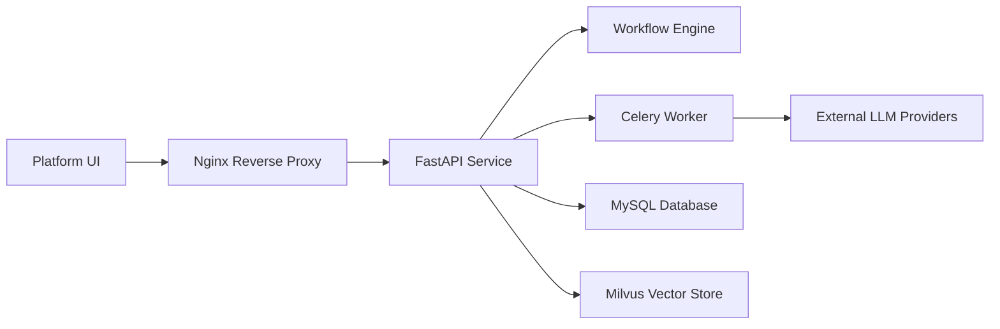

# dataelement/bisheng

> Self-hosted enterprise LLM application platform: visual workflows, agents, RAG, document parsing.

## The problem
Deploying LLM applications in the enterprise (document review, reports, customer service) requires orchestration, RBAC and reliable parsing.

## What it actually does
Workflow editor with loops, parallelism, batch processing, conditions and human intervention during execution.
"Lingsight" agent guided by an AGL language that encodes business expertise.
Enterprise features: RBAC, groups, SSO/LDAP, quotas, monitoring.
FastAPI + Celery backend, React frontends, MySQL, Redis, Elasticsearch, Milvus, OnlyOffice; a private OCR/table model can be deployed.

## How it is wired


## Trying it
```bash
git clone https://github.com/dataelement/bisheng.git
cd bisheng/docker
docker compose -f docker-compose.yml -p bisheng up -d
```

## Cost and gotchas
Minimum 4 vCPU and 16 GB of RAM, 18 vCPU/48 GB recommended; ES, Milvus and OnlyOffice are installed by default.
External LLM models are at your expense.

## What it is not
Not a lightweight framework: it is a full stack to operate.
Documentation and ecosystem are largely oriented toward the Chinese market.

## Alternatives
No alternative named in the README.

## For you
Worth watching if you need to provide an internal LLM platform with workflows and RBAC: heavy to host, but it covers what frameworks leave out.
