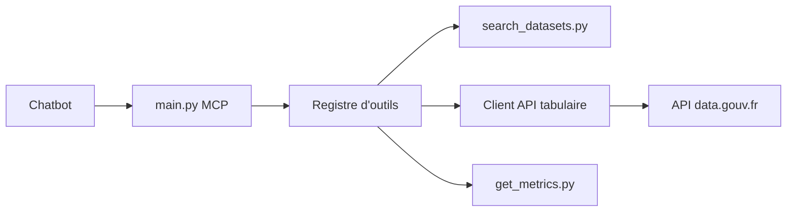

# datagouv/datagouv-mcp

> MCP server that lets an assistant query the data.gouv.fr datasets in conversation.

## The problem
Finding and reading French open data means browsing the site and downloading files by hand.

## What it actually does
A Python MCP server over HTTP exposing read-only tools: search for datasets and organizations, details of datasets and resources, querying of tabular resources (CSV up to 100 MB, XLSX 12.5 MB), visit and download metrics, search for third-party APIs and a summary of their OpenAPI specification. A public instance is open, with no key. The code includes safeguards against SSRF requests and a health endpoint.

## How it is wired


## Trying it
```bash
claude mcp add --transport http datagouv https://mcp.data.gouv.fr/mcp
git clone git@github.com:datagouv/datagouv-mcp.git
cd datagouv-mcp
docker compose up -d
uv run main.py
```

## Cost and gotchas
Free, no API key. The public instance depends on a third-party service and the network. The code includes usage analytics (Matomo) and optional Sentry error tracking (disabled without `SENTRY_DSN`). The metrics tool only works in production.

## What it is not
Not a local database: each question queries the API live. Tabular queries are limited by pagination and file size; beyond that, you have to fetch the file.

## Alternatives
No alternative named in the README.

## For you
Adopt: an immediate, free connection to French open data for an assistant, useful for exploring datasets before a data project; check the telemetry if you self-host.
