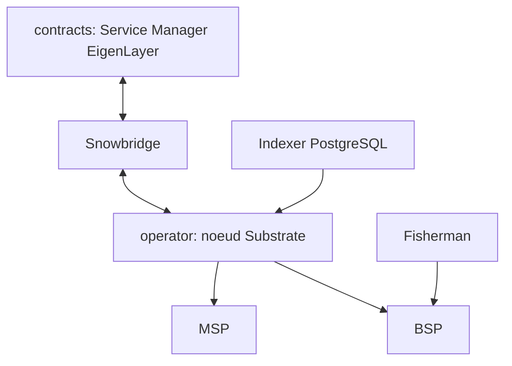

# datahaven-xyz/datahaven

> Verifiable decentralized storage network, secured by EigenLayer, for training data and models.

## The problem
Proving that a dataset or model weights stored with third parties have not been tampered with.

## What it actually does
Files are split, hashed into Merkle trees and their root is anchored on-chain. Main and backup storage providers replicate the data, with slashing on failed proof challenges. Validators are secured by Ethereum restaking; a Snowbridge bridge links Ethereum and the Substrate chain.

## How it is wired


## Trying it
```bash
cd test
bun i
bun cli launch
```
Tests: `bun test:e2e`. Contracts: `cd contracts && forge build`. Node: `cd operator && cargo build --release --features fast-runtime`.

## Cost and gotchas
Heavy prerequisites: Kurtosis, Bun 1.3.2+, Docker, Foundry, Rust, optional Helm. Local launch deploys a full Ethereum network, hence a cost in RAM and time.

## What it is not
Not a ready-to-use storage service: it is the code of a blockchain network. The README cites AI as a use case but documents no read SDK for an ML pipeline.

## Alternatives
No alternative named in the README (StorageHub is a building block used).

## For you
Ignore: blockchain stack (Substrate, Solidity) far from everyday data/AI work, and last push in April 2026.
