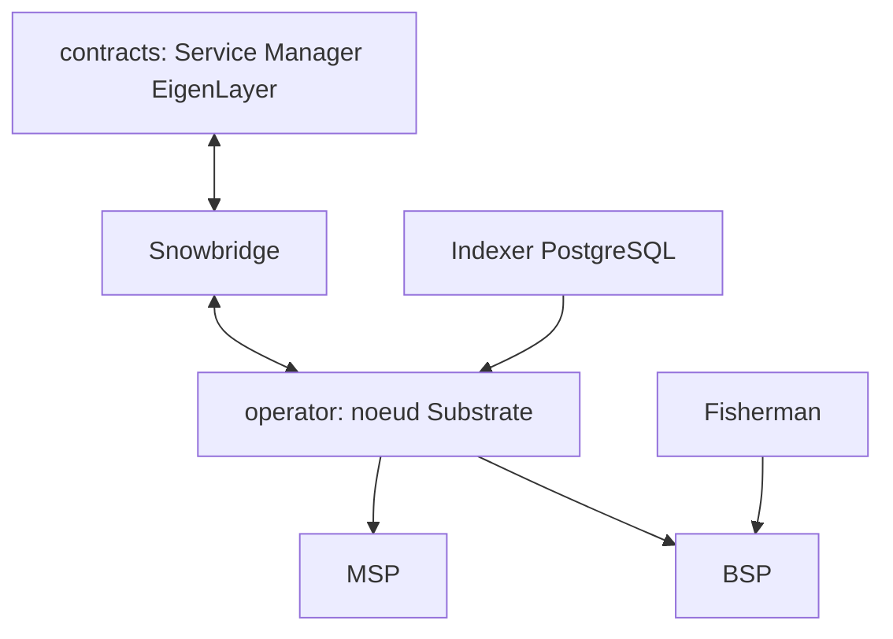

# datahaven-xyz/datahaven

> Réseau de stockage décentralisé vérifiable, sécurisé par EigenLayer, pour données d'entraînement et modèles.

## Le problème
Prouver qu'un jeu de données ou des poids de modèle stockés chez des tiers n'ont pas été altérés.

## Ce que ça fait vraiment
Les fichiers sont découpés, hachés en arbres de Merkle et leur racine est ancrée on-chain. Des fournisseurs de stockage principaux et de secours répliquent les données, avec slashing en cas d'échec aux défis de preuve. Les validateurs sont sécurisés par le restaking Ethereum ; un pont Snowbridge relie Ethereum et la chaîne Substrate.

## Comment c'est branché


## Essayer
```bash
cd test
bun i
bun cli launch
```
Tests : `bun test:e2e`. Contrats : `cd contracts && forge build`. Noeud : `cd operator && cargo build --release --features fast-runtime`.

## Coût et pièges
Prérequis lourds : Kurtosis, Bun 1.3.2+, Docker, Foundry, Rust, Helm optionnel. Le lancement local déploie un réseau Ethereum complet, d'où un coût en RAM et en temps.

## Ce que ce n'est pas
Pas un service de stockage prêt à l'emploi : c'est le code d'un réseau blockchain. Le README cite l'IA comme cas d'usage mais ne documente aucun SDK de lecture pour un pipeline ML.

## Alternatives
Aucune alternative nommée dans le README (StorageHub est une brique utilisée).

## Pour toi
À ignorer : stack blockchain (Substrate, Solidity) éloignée d'un travail data/IA courant, et dernier push en avril 2026.

