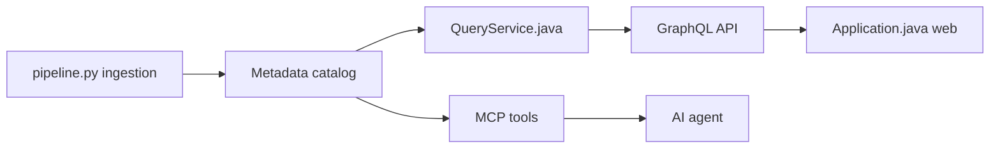

# datahub-project/datahub

> Open-source metadata catalog to discover, govern and observe data, including through AI agents.

## The problem
In a fragmented data stack, finding the right table, its lineage and its owner is laborious.

## What it actually does
Ingests metadata (80+ connectors: Snowflake, BigQuery, dbt, Airflow...) in batch or streaming via Kafka, then exposes it through search, lineage, governance, GraphQL/OpenAPI APIs and a web interface. An MCP server (`@acryldata/mcp-server-datahub`) connects Cursor, Claude Desktop or Cline; an open-source analytics agent is offered in a separate repository.

## How it is wired


## Trying it
```bash
pip install acryl-datahub
datahub docker quickstart
# Access: http://localhost:9002 (default credentials datahub / datahub)
```

## Cost and gotchas
Docker Desktop with 8 GB of RAM or more. Full stack (GMS, Elasticsearch, MySQL, Kafka). A managed offering, DataHub Cloud, exists. Default credentials must be changed.

## What it is not
It is not the datahub.io site (a separate dataset hosting service).

## Alternatives
Not documented: the README names no alternative.

## For you
Adopt it if your organization has several data sources and needs lineage: Apache-2.0, recent activity; factor in the heavy stack.
