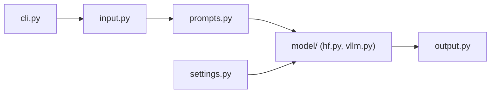

# datalab-to/chandra

> OCR model that converts images and PDFs into Markdown, HTML or JSON with layout.

## The problem
Extracting documents (tables, formulas, handwriting, forms) without losing structure is hard.

## What it actually does
The package normalizes pages, builds prompts, calls a backend (local HuggingFace or a vLLM server) and writes `.md`, `.html`, `_metadata.json` and the extracted images. The README claims 90+ languages; scores come from in-house benchmarks and olmocr.

## How it is wired


## Trying it
```bash
pip install chandra-ocr
chandra_vllm
chandra input.pdf ./output
pip install chandra-ocr[hf]
chandra input.pdf ./output --method hf
```

## Cost and gotchas
The code is Apache-2.0, but the weights follow a modified OpenRAIL-M license: free for research, personal use and startups under $2M, no use competing with their API. `chandra_vllm` launches a Docker container and requires a GPU.

## What it is not
Not fully free for commercial use: the README points to a paid license. The hosted version is presented as more accurate than the open weights.

## Alternatives
olmocr, dots.ocr and Deepseek OCR appear in the comparison table; the README does not explicitly recommend them.

## For you
Worth watching: very useful for document extraction, but check the weights license before any enterprise use.
