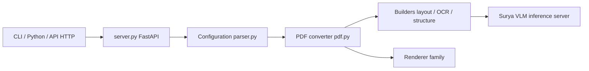

# datalab-to/marker

> Converts PDF, images, Office, HTML and EPUB into Markdown, JSON, HTML or chunks, for document pipelines.

## The problem
Cleanly extracting text, tables, formulas and images from a PDF for a RAG or analysis pipeline is fragile.

## What it actually does
Same project as VikParuchuri/marker (identical README). It reads the PDF text, detects the layout, and routes scanned or damaged pages, equations and uncertain tables through a local surya VLM. `balanced` (GPU) and `fast` (CPU) modes. According to the architecture: FastAPI API (`server.py`), converters, providers, builders (layout, OCR, structure), processors, renderers, optional LLM via OpenRouter.

## How it is wired


## Trying it
```bash
pip install marker-pdf
marker_single /path/to/file.pdf
marker /path/to/input/folder --skip_existing
marker_gui
marker_server --port 8001
```

## Cost and gotchas
Code under Apache 2.0; model weights under a modified Open Rail-M license (free for research, personal use and startups under $5M). `--use_llm` sends documents to a third-party provider with a key at your expense. `balanced` mode requires Docker and an NVIDIA GPU; `fast` runs on CPU.

## What it is not
Not a state-of-the-art full-page OCR (for that: Chandra, surya). Forms and very complex nested tables remain a limit. The built-in API is "not very robust".

## Alternatives
- MinerU: compared in the README, slower.
- docling: compared, lower score.
- Chandra: hosted model, more accurate.

## For you
Adopt it to prepare PDF corpora before indexing; treat it as a duplicate of VikParuchuri/marker, to be counted only once.
