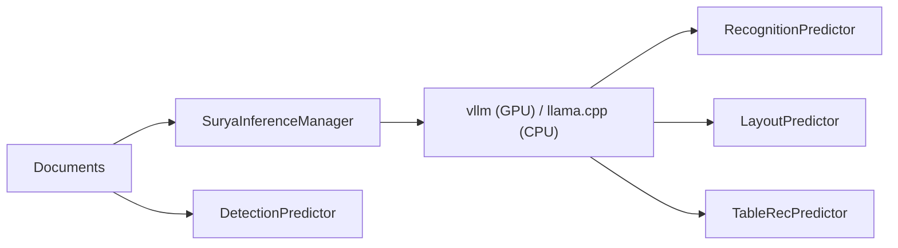

# datalab-to/surya

> 650M-parameter OCR model with layout and table support, for extracting text from multilingual documents.

Note: README identical to `VikParuchuri/surya` (same creation, same issues); the two entries most likely refer to the same project.

## The problem
Turning documents (PDFs, scans, forms, handwritten notes) into structured text with reading order and tables.

## What it actually does
A single vision-language model (Qwen3.5-like architecture, about 650M parameters) produces the layout as JSON or the page as HTML, depending on the prompt. It is served by `vllm` or `llama.cpp`, launched by `SuryaInferenceManager`. Math comes out as KaTeX-compatible LaTeX. Line detection is a separate EfficientViT model. The scores (83.3% olmOCR-bench, 87.2% across 91 languages) are the publisher's own.

## How it is wired


## Trying it
```bash
pip install surya-ocr
surya_ocr DATA_PATH --keep_server
surya_layout DATA_PATH
surya_table DATA_PATH
pip install streamlit pdftext
surya_gui
```

## Cost and gotchas
Code under Apache 2.0, weights under a modified Open Rail-M license (free for research, personal use, and startups under $5M in funding or revenue). The server restarts with every command unless `--keep_server` is used. The publisher also offers a paid platform (5 $ of free credits).

## What it is not
Not an OCR for photos. Going from v1 to v2 changes the output schemas (`text_lines` becomes `blocks`).

## Alternatives
Chandra OCR 2, dots.mocr, LightOnOCR 2-1B, olmOCR (all in the README table).

## For you
Adopt it for document ingestion in a RAG or extraction pipeline: good announced size/score ratio, subject to the weights license.
