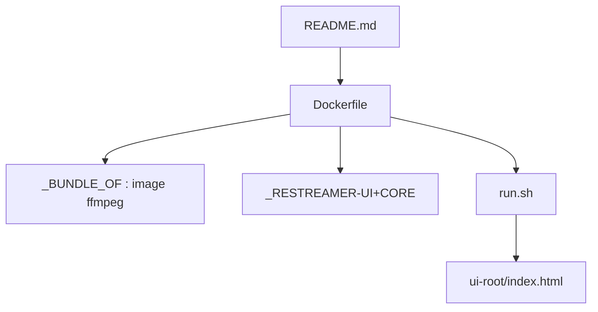

# datarhei/restreamer

> Docker application to broadcast and relay live video streams to platforms, with a web interface.

## The problem
Sending a camera stream to YouTube Live or a media server means configuring FFmpeg and a streaming server by hand.

## What it actually does
A web wizard configures inputs and outputs: several protocols (RTMP, SRT, HLS), relay to YouTube Live or Wowza, built-in VideoJS player, automatic Let's Encrypt certificates, bandwidth monitoring and a documented REST API. Hardware acceleration (Raspberry Pi, Nvidia CUDA, Intel VAAPI) is supported. The repository assembles ffmpeg, core and interface images.

## How it is wired


## Trying it
```bash
docker run -d --restart=always --name restreamer \
   -v /opt/restreamer/config:/core/config -v /opt/restreamer/data:/core/data \
   -p 8080:8080 -p 8181:8181 \
   -p 1935:1935 -p 1936:1936 \
   -p 6000:6000/udp \
   datarhei/restreamer:latest
```

## Cost and gotchas
Free. Docker required; `--privileged` for local USB cameras and router port forwarding for external access. Commercial support is offered by the publisher.

## What it is not
It is not a video editing or video AI tool: it relays streams. The backend and interface code lives in other repositories.

## Alternatives
No alternative named in the README.

## For you
Ignore: live video broadcasting, of no data or MLOps interest, except for an occasional camera relay need.
