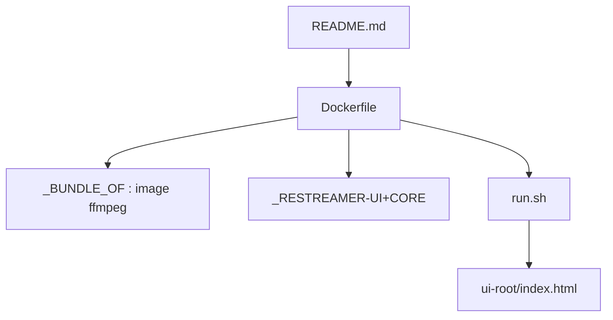

# datarhei/restreamer

> Application Docker pour diffuser et relayer des flux vidéo en direct vers des plateformes, avec interface web.

## Le problème
Envoyer un flux de caméra vers YouTube Live ou un serveur multimédia demande de configurer FFmpeg et un serveur de diffusion à la main.

## Ce que ça fait vraiment
Un assistant web configure entrées et sorties : plusieurs protocoles (RTMP, SRT, HLS), relais vers YouTube Live ou Wowza, lecteur VideoJS intégré, certificats Let's Encrypt automatiques, surveillance de la bande passante et API REST documentée. L'accélération matérielle (Raspberry Pi, Nvidia CUDA, Intel VAAPI) est prise en charge. Le dépôt assemble des images ffmpeg, core et interface.

## Comment c'est branché


## Essayer
```bash
docker run -d --restart=always --name restreamer \
   -v /opt/restreamer/config:/core/config -v /opt/restreamer/data:/core/data \
   -p 8080:8080 -p 8181:8181 \
   -p 1935:1935 -p 1936:1936 \
   -p 6000:6000/udp \
   datarhei/restreamer:latest
```

## Coût et pièges
Gratuit. Docker requis ; `--privileged` pour les caméras USB locales et redirection de ports du routeur pour l'accès externe. Un support commercial est proposé par l'éditeur.
## Ce que ce n'est pas
Ce n'est pas un outil de montage ni d'IA vidéo : il relaie des flux. Le code du backend et de l'interface vit dans d'autres dépôts.

## Alternatives
Aucune alternative nommée dans le README.

## Pour toi
À ignorer : diffusion vidéo en direct, sans intérêt data ou MLOps, sauf pour un besoin ponctuel de relais de caméra.

