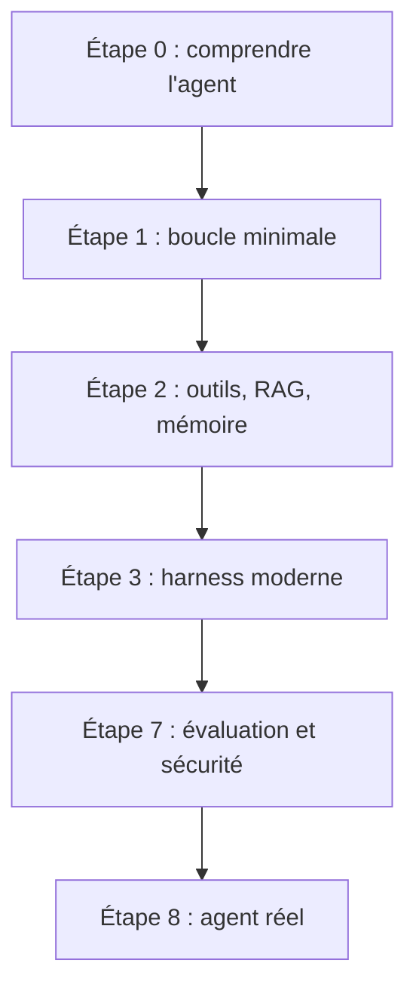

# datawhalechina/Agent-Learning-Hub

> Annotated roadmap for learning to build reliable AI agents, with projects and resources.

## The problem
Resources on agents are scattered and age quickly, with no learning order.

## What it actually does
A single README organized in stages from 0 to 8: minimal agent loop, tools, RAG and memory, harness, multi-agents, skills and protocols (MCP, A2A, ACP), browser agents, evaluation and security, going to production. It adds a project path (from a calculator to a production harness), official guides, articles and repositories. Texts in Chinese and English.

## How it is wired


## Trying it
```bash
# Aucune commande : suivre le Learning Todo List dans le README, étape par étape.
```

## Cost and gotchas
Free. The proposed projects require their own API keys. Last push in July 2026.

## What it is not
Not an interactive course nor runnable code. The repository lists are pointers, not recommendations verified here.

## Alternatives
datawhalechina/hello-agents (agent tutorial), shareAI-lab/learn-claude-code, microsoft/ai-agents-for-beginners, all cited in the README.

## For you
Adopt: up-to-date roadmap on agents, memory, evaluations and MCP, directly useful to an AI profile.
