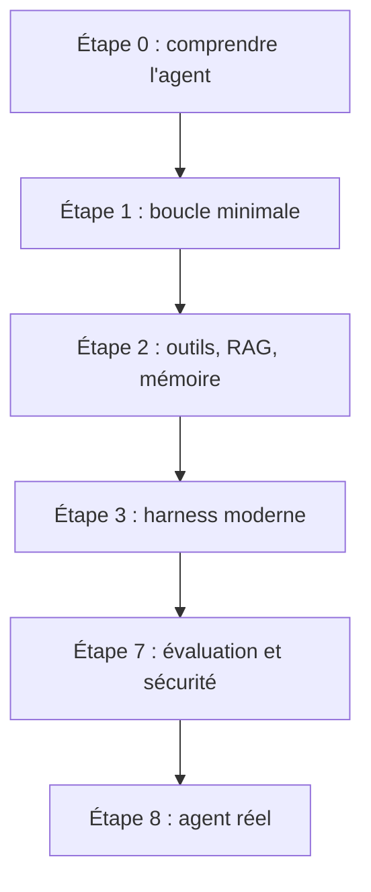

# datawhalechina/Agent-Learning-Hub

> Feuille de route commentée pour apprendre à construire des agents IA fiables, avec projets et ressources.

## Le problème
Les ressources sur les agents sont éparses et vieillissent vite, sans ordre d'apprentissage.

## Ce que ça fait vraiment
Un seul README organisé en étapes de 0 à 8 : boucle d'agent minimale, outils, RAG et mémoire, harness, multi-agents, skills et protocoles (MCP, A2A, ACP), agents navigateur, évaluation et sécurité, mise en production. Il ajoute un parcours de projets (calculatrice à harness de production), guides officiels, articles et dépôts. Textes en chinois et en anglais.

## Comment c'est branché


## Essayer
```bash
# Aucune commande : suivre le Learning Todo List dans le README, étape par étape.
```

## Coût et pièges
Gratuit. Les projets proposés demandent leurs propres clés d'API. Dernier push en juillet 2026.

## Ce que ce n'est pas
Pas un cours interactif ni un code exécutable. Les listes de dépôts sont des pointeurs, pas des recommandations vérifiées ici.

## Alternatives
datawhalechina/hello-agents (tutoriel d'agents), shareAI-lab/learn-claude-code, microsoft/ai-agents-for-beginners, tous cités dans le README.

## Pour toi
Adopter : feuille de route à jour sur les agents, la mémoire, les évaluations et MCP, directement utile à un profil IA.

