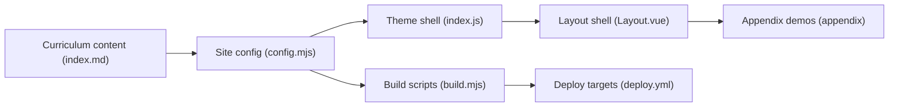

# datawhalechina/easy-vibe

> Multilingual online curriculum for learning to code with AI, from beginner to agents.

## The problem
Beginners and product people want to build with "vibe coding" tools without knowing where to start, and forget what they learn for lack of a learning path.

## What it actually does
Static VitePress site in 10 languages, organized in stages: getting started, prototypes, full-stack, then Claude Code, MCP, Skills, agents.
Interactive Vue components: animated demos, a clickable RAG walkthrough, terminal visualizations.
An appendix of more than 80 topics on computer science fundamentals, frontend/backend, infrastructure, AI.
Guided projects: an AI writing SaaS, an online exam system, mobile and desktop apps.

## How it is wired


## Trying it
```bash
npm install
npm run dev
```

## Cost and gotchas
Free. The courses point to tools (Claude Code, Stripe, Supabase) that have their own costs.

## What it is not
Not a library or a tool. Content mostly designed for beginners; Chinese is the most complete version. No license declared for the content.

## Alternatives
No named alternative; the README points to two other courses from the team.

## For you
Ignore: beginner curriculum; only the advanced sections on Claude Code and RAG could serve as material to train colleagues.
