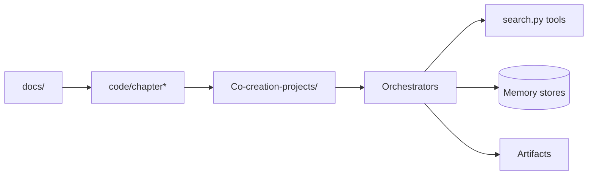

# datawhalechina/hello-agents

> A 16-chapter course in Chinese, covering everything from theory to practical projects, on building LLM agents.

## The problem
The tutorials on agents are scattered and often focused on a single framework, without any progression or practical application.

## What it actually does
An online book (in five parts: basics (definitions, history, LLMs), hand-coded paradigms (ReAct, Plan-and-Solve, Reflection), low-code platforms, frameworks (AutoGen, AgentScope, LangGraph), creating your own framework, then memory/RAG, context, protocols (MCP, A2A, ANP), Agentic RL (SFT → GRPO), evaluation) is available as a PDF.

`code/chapter*` provides demos for each chapter; `Co-creation-projects/` gathers complete applications from contributors (research, travel, writing) on a single schema: UI/API → agents → tools → memory → artifacts.

## How it is wired

## Trying it
No documented commands in the README: online reading or PDF, code located in `code/`.

## Cost and gotchas
Free content; the examples call LLMs and search APIs via `.env`, so you are responsible for providing the keys. The text is in Chinese.

## What it is not
This is not a framework intended for production use; the HelloAgents framework is designed for learning. Community projects vary in quality, and each has its own architecture.

## Alternatives
- Dify, Coze, and n8n – low-code platforms covered in Chapter 5, if you want to assemble applications without coding.
- AutoGen, AgentScope, and LangGraph – frameworks discussed in Chapter 6, which can be used directly for construction.

## For you
Worth noting: the chapters on Agentic RL and evaluation are particularly insightful, if you can read them in Chinese.
