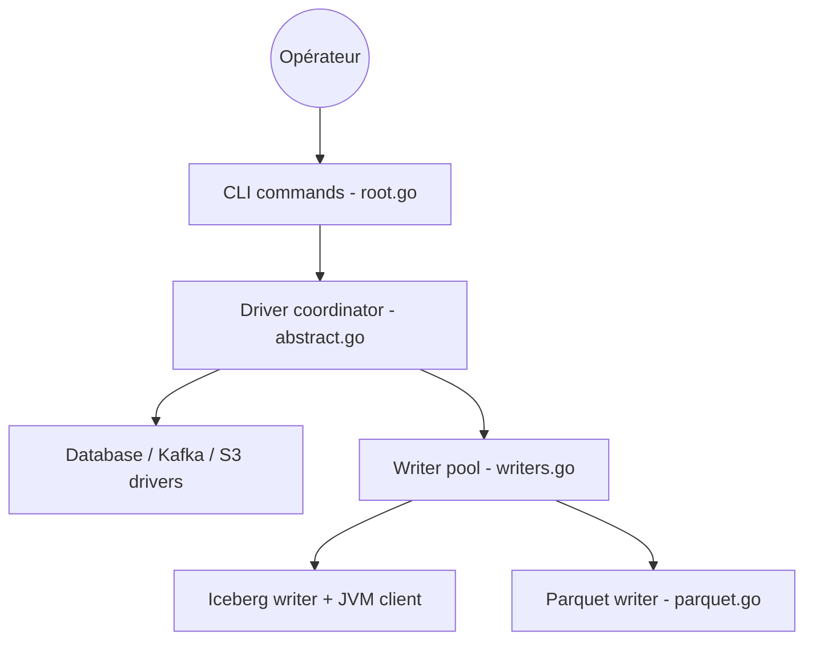

# datazip-inc/olake-go

> Ingestion engine that replicates databases, S3 and Kafka to Apache Iceberg or Parquet, with CDC.

## The problem
Feeding an Iceberg lakehouse from transactional databases often goes through Spark, Flink, Kafka and Debezium, which are heavy to operate.

## What it actually does
A Go binary with the commands `spec`, `check`, `discover`, `sync` and `clear-destination`. Sources: PostgreSQL, MySQL, MongoDB, Oracle, DB2, MSSQL, S3 and Kafka (bounded incremental). Modes: full load, incremental and CDC (depending on the source). Destinations: Iceberg (Glue, Hive, JDBC, REST catalogs) through a Java gRPC service, or Parquet. A web interface drives sources, jobs and destinations.

## How it is wired


## Trying it
```bash
curl -sSL https://raw.githubusercontent.com/datazip-inc/olake-ui/master/docker-compose-v1.yml | docker compose -f - up -d
```
The interface opens at http://localhost:8000 (default credentials: `admin` / `password`).

## Cost and gotchas
Free, but object storage and cloud catalogs are on you. Change the default credentials. Oracle CDC is "in progress", DB2 does not have it. The benchmarks against Fivetran and Flink are published by the vendor.

## What it is not
Not a query engine or a warehouse: it loads the data, you query it with Trino, Athena, Spark or something else. No table maintenance (that is the neighboring project olake-fusion).

## Alternatives
- Fivetran: managed service, no infrastructure; the README uses it as a speed reference.
- Flink: alternative for Kafka to Iceberg, faster according to the README table.

## For you
Worth watching to feed a lakehouse from production databases without Spark; check the figures on your own volumes.
