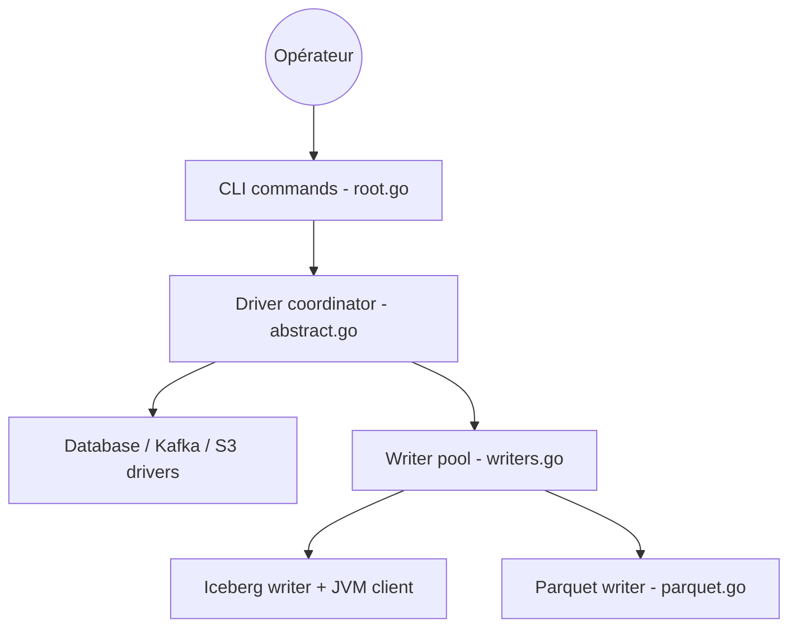

# datazip-inc/olake-go

> Moteur d'ingestion qui réplique bases, S3 et Kafka vers Apache Iceberg ou Parquet, avec CDC.

## Le problème
Alimenter un lakehouse Iceberg depuis des bases transactionnelles passe souvent par Spark, Flink, Kafka et Debezium, lourds à exploiter.

## Ce que ça fait vraiment
Un binaire Go avec commandes `spec`, `check`, `discover`, `sync` et `clear-destination`. Sources : PostgreSQL, MySQL, MongoDB, Oracle, DB2, MSSQL, S3 et Kafka (incrémental borné). Modes : charge complète, incrémental et CDC (selon la source). Destinations : Iceberg (catalogues Glue, Hive, JDBC, REST) via un service Java gRPC, ou Parquet. Une interface web pilote sources, jobs et destinations.

## Comment c'est branché


## Essayer
```bash
curl -sSL https://raw.githubusercontent.com/datazip-inc/olake-ui/master/docker-compose-v1.yml | docker compose -f - up -d
```
L'interface s'ouvre sur http://localhost:8000 (identifiants par défaut : `admin` / `password`).

## Coût et pièges
Gratuit, mais le stockage objet et les catalogues cloud sont à ta charge. Changer les identifiants par défaut. Le CDC Oracle est « en cours », DB2 ne l'a pas. Les benchmarks comparés à Fivetran et Flink sont publiés par l'éditeur.

## Ce que ce n'est pas
Pas un moteur de requêtes ni un entrepôt : il charge les données, tu les interroges avec Trino, Athena, Spark ou autre. Pas de maintenance de tables (c'est le projet voisin olake-fusion).

## Alternatives
- Fivetran : service géré, sans infrastructure ; le README l'utilise comme référence de vitesse.
- Flink : alternative pour Kafka vers Iceberg, plus rapide selon le tableau du README.

## Pour toi
À surveiller pour alimenter un lakehouse depuis des bases de production sans Spark ; contrôle les chiffres sur tes propres volumes.

