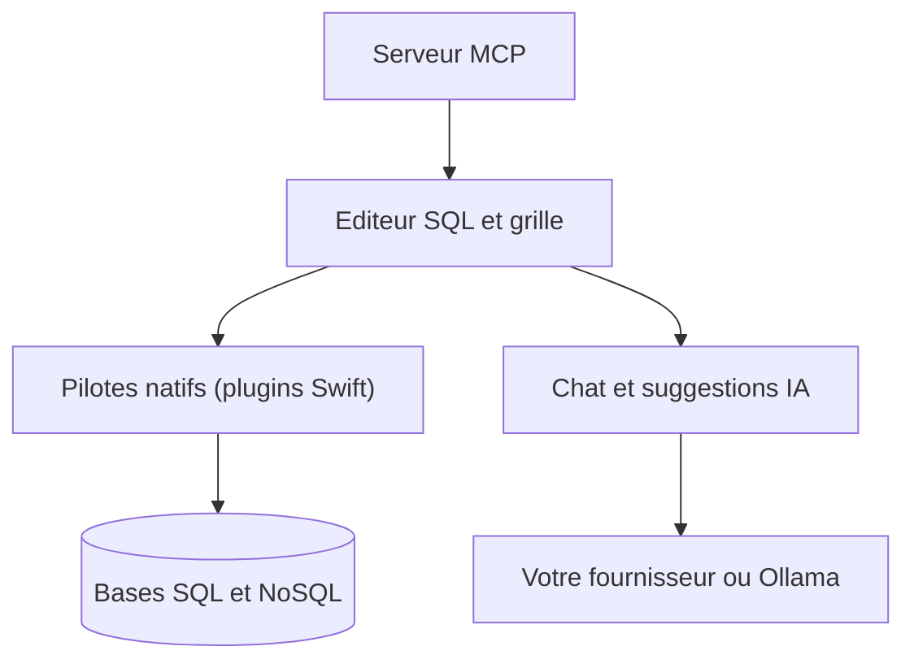

# datlechin/TablePro

> Native database client for macOS and iOS, multi-engine SQL and NoSQL, with built-in AI.

## The problem
Native multi-database clients on Mac are either proprietary (TablePlus), single-engine, or heavy (JVM or Electron).

## What it actually does
SQL editor with autocompletion, editable data grid, SSH tunnels, query history and native drivers. The AI offers chat and inline suggestions, with your own key or local Ollama. An MCP server lets Cursor, Raycast or Claude Desktop query your databases.

## How it is wired

Simplified diagram based on the sheet, no diagram provided.

## Trying it
```bash
brew install --cask tablepro
```

## Cost and gotchas
Free on all databases, with no limited trial; the Pro and Team plans add iCloud Sync, result charts and other features on Mac. The AI assumes your API key. AGPL-3.0 license. Linux in development, Windows not.

## What it is not
It is not cross-platform: macOS 13+ and iOS 18+ only. Pro features are paid despite the open code.

## Alternatives
The README mentions TablePlus (proprietary), Sequel Ace, Postico, DBeaver, Beekeeper Studio and DBGate.

## For you
Worth watching if you work on Mac with several databases: MCP access to the databases is interesting, but the project relies on a single person.
