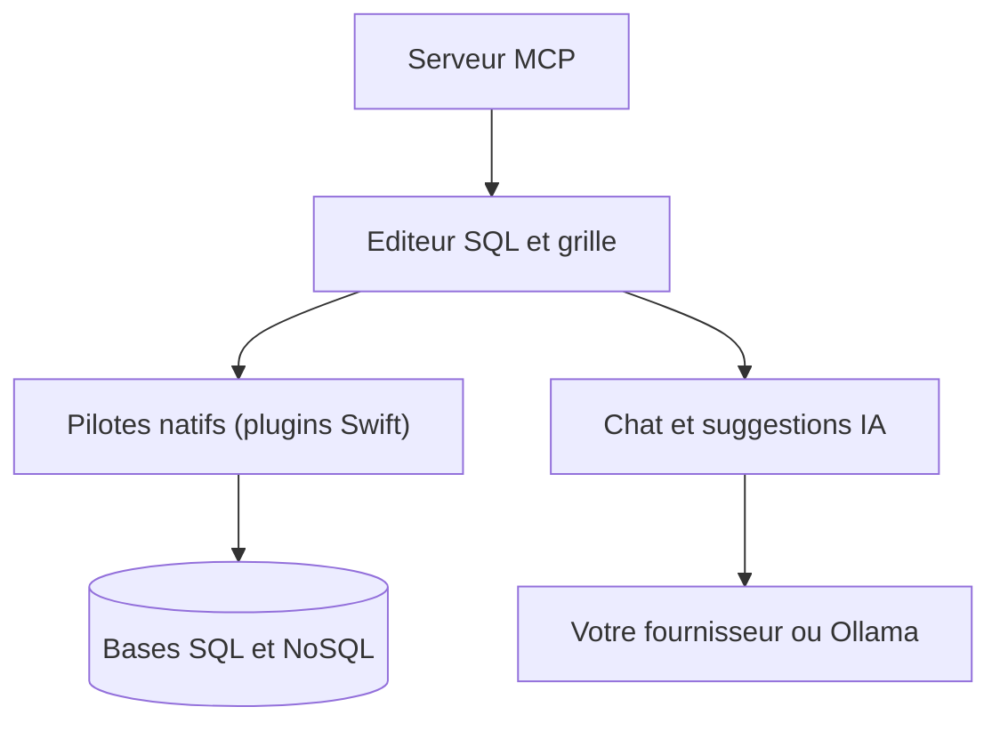

# datlechin/TablePro

> Client de base de données natif pour macOS et iOS, multi-moteurs SQL et NoSQL, avec IA intégrée.

## Le problème
Les clients multi-bases natifs sur Mac sont soit propriétaires (TablePlus), soit mono-moteur, soit lourds (JVM ou Electron).

## Ce que ça fait vraiment
Éditeur SQL avec autocomplétion, grille de données éditable, tunnels SSH, historique de requêtes et pilotes natifs. L'IA propose chat et suggestions en ligne, avec ta propre clé ou Ollama en local. Un serveur MCP permet à Cursor, Raycast ou Claude Desktop d'interroger tes bases.

## Comment c'est branché

Schéma simplifié d'après la fiche, sans diagramme fourni.

## Essayer
```bash
brew install --cask tablepro
```

## Coût et pièges
Gratuit sur toutes les bases, sans essai limité ; les plans Pro et Team ajoutent iCloud Sync, graphiques de résultats et autres fonctions sur Mac. L'IA suppose ta clé d'API. Licence AGPL-3.0. Linux en développement, Windows non.

## Ce que ce n'est pas
Ce n'est pas multiplateforme : macOS 13+ et iOS 18+ seulement. Les fonctions Pro sont payantes malgré le code ouvert.

## Alternatives
Le README cite TablePlus (propriétaire), Sequel Ace, Postico, DBeaver, Beekeeper Studio et DBGate.

## Pour toi
À surveiller si tu travailles sur Mac avec plusieurs bases : l'accès MCP aux bases est intéressant, mais le projet repose sur une seule personne.

