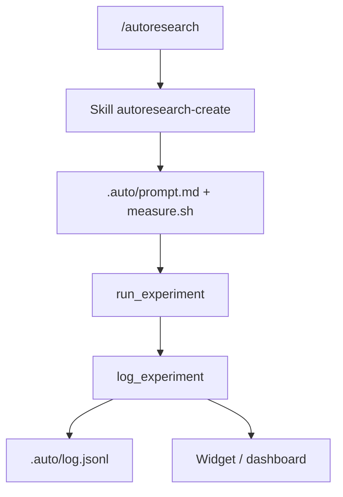

# davebcn87/pi-autoresearch

> Extension for the pi coding agent: an autonomous loop that tries, measures, keeps or reverts optimizations.

## The problem
Optimizing a metric (test time, bundle size, training) through successive trials takes discipline and result tracking.

## What it actually does
Provides three tools (`init_experiment`, `run_experiment`, `log_experiment`), a widget, a dashboard and the `/autoresearch` command. The agent modifies, commits, measures, keeps or reverts, and logs to `.auto/log.jsonl`. A MAD-based confidence score indicates whether the gain exceeds the noise.

## How it is wired


## Trying it
```bash
pi install npm:pi-autoresearch
pi
```
```text
/autoresearch optimize unit test runtime, monitor correctness
```

## Cost and gotchas
A loop that does not stop on its own: it can consume a lot of tokens. Cap it with `maxIterations` and the API key's limits. You need to install pi and an LLM provider key.

## What it is not
Not a standalone tool: it depends on pi. It runs scripts (measure.sh, hooks) with your permissions and creates/reverts commits: run it on a dedicated branch.

## Alternatives
karpathy/autoresearch, which it takes inspiration from (cited by the README).

## For you
Worth watching: useful for automating the optimization of training runs or benchmarks, if you already use pi; otherwise the interest is low.
