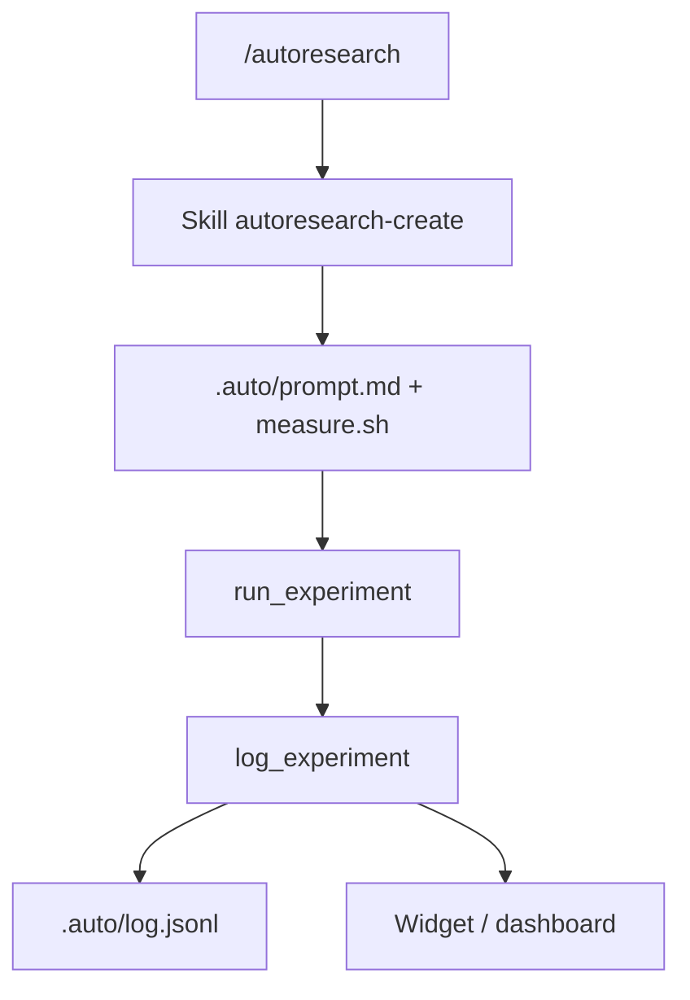

# davebcn87/pi-autoresearch

> Extension pour l'agent de code pi : boucle autonome qui essaie, mesure, garde ou annule les optimisations.

## Le problème
Optimiser une métrique (temps de tests, taille de bundle, entraînement) par essais successifs demande de la discipline et un suivi des résultats.

## Ce que ça fait vraiment
Fournit trois outils (`init_experiment`, `run_experiment`, `log_experiment`), un widget, un tableau de bord et la commande `/autoresearch`. L'agent modifie, commite, mesure, garde ou annule, et journalise dans `.auto/log.jsonl`. Un score de confiance basé sur la MAD signale si le gain dépasse le bruit.

## Comment c'est branché


## Essayer
```bash
pi install npm:pi-autoresearch
pi
```
```text
/autoresearch optimize unit test runtime, monitor correctness
```

## Coût et pièges
Boucle qui ne s'arrête pas seule : elle peut consommer beaucoup de jetons. Plafonner avec `maxIterations` et les limites de la clé d'API. Il faut installer pi et une clé de fournisseur LLM.

## Ce que ce n'est pas
Pas un outil autonome : il dépend de pi. Il exécute des scripts (measure.sh, hooks) avec tes droits et crée/annule des commits : à lancer sur une branche dédiée.

## Alternatives
karpathy/autoresearch, dont il s'inspire (cité par le README).

## Pour toi
À surveiller : utile pour automatiser l'optimisation d'entraînements ou de benchmarks, si tu utilises déjà pi ; sinon l'intérêt est faible.

