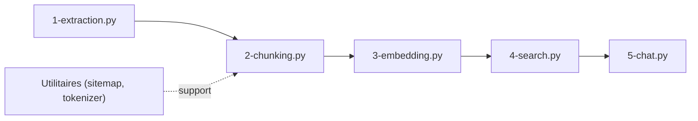

# daveebbelaar/ai-cookbook

> Collection of copy-ready code examples for building AI systems, by an independent AI engineer.

## The problem
Finding concrete examples of RAG pipelines and LLM workflow patterns to reuse.

## What it actually does
The README is very short (an introduction of the author). From the code: a knowledge pipeline in five scripts (extraction, chunking, embedding, search, chat, with Docling) and a folder of workflow patterns (prompt chaining, routing, parallelization, orchestrator). The README details neither prerequisites nor how to run it.

## How it is wired


## Trying it
```bash
# Aucune commande documentée dans le README.
# Le dépôt fournit un fichier .env.example pour les clés.
```

## Cost and gotchas
LLM provider API keys are probably at your expense (not documented). The README also promotes the author's courses and services.

## What it is not
Not a library or a package: independent teaching scripts.

## Alternatives
No alternative named in the README.

## For you
Worth watching: a source of ideas for a Docling→RAG pipeline and workflow patterns, but without run documentation you will have to read the scripts yourself.
